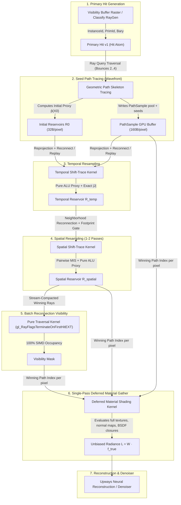

# ReSTIR PT Design — Path-Space Reservoir Resampling & Decoupled Architecture

**Status:**
- **Phase 1 (Completed 2026-10-10):** Inline ReSTIR DI subsystem, shared `restir_common.glsl`, temporal + spatial-tap reuse for analytical lights (`docs/reports/restir_review_2026_10_10.md`).
- **Phase 2a (Completed 2026-10-11):** Path-space secondary-vertex ReSTIR GI at bounce 1, X1 context buffer, continuous random 2D spatial rotation, target ratio and weight clamping (`commit d5e4fab`).
- **Phase 2b (Partial — 2026-10-11):** Decoupled ReSTIR PT — winner replay visibility decoupled to shadow ray queue (`commit 5d35634`), eliminating inline `rayQuery` from replay evaluation (candidate generation retains synchronous inline rayQuery for shadowed $\hat{L}_2$ storage), 16-byte `Hit` atom and position fetch (`commit 165c804`), transient ShadeRequest/ShadeResult queues, and exact analytical reconnection Jacobians with hybrid shift map gating.
- **Phase 3 (Long-Term Architectural Target):** Fully Inverted / Deferred Gather Path-Database Architecture (pure geometry/visibility resampling with end-of-frame deferred material closure evaluation).

---

## 1. Executive Architectural Summary

ReSTIR PT (*Path-Space Reservoir Spatio-Temporal Importance Resampling*) resamples light transport paths across space and time. However, how the resampling pipeline is structured determines whether the engine achieves real-time frame rates or collapses under GPU hardware penalties.

Two major decoupled architectures exist for production-grade ReSTIR PT in Vulkan 1.4:

1. **Approach A: Request / Result Wavefront Ping-Pong (Lin et al. 2022, GRIS)**
   - **Premise:** Geometry kernels trace rays and evaluate shift mappings; when they reach a reconnected vertex, they emit a lightweight `ShadeRequest`. Specialized material kernels evaluate BSDF $(f, \text{pdf})$ binned by material class, and a resolve pass computes exact Jacobians and MIS weights.
   - **Key Advantage:** Resampling operates on the **exact** target function $\hat{p}$ and true BSDF lobes at every step, maximizing convergence and maintaining mathematical unbiasedness.

2. **Approach B: Fully Inverted / Deferred Gather Path-Database (Bitterli et al., Benty et al. 2023)**
   - **Premise:** Treat the renderer as a **path-sampling database with a deferred material evaluator**. Reservoirs store pure geometric path topology and sampling provenance (seeds, vertices, hints). Resampling, shifting, and visibility-validation operate with **zero material code**, using geometric target proxies. Materials and spectral closures are evaluated **only on the surviving paths at the end of the frame**.
   - **Key Advantage:** Maximum architectural purity and theoretical peak SIMD efficiency. Resampling kernels never load textures, evaluate closures, or ping-pong with material passes.

Below is the complete specification of both paradigms, followed by Pathways' progressive adoption path.

---

## 2. The Core Problem: Why Shading and Geometry Must Never Mix

In a naive or prototype ReSTIR implementation (including Pathways Phase 2a), visibility testing and path shifting are performed inline inside the material shading shader (`wavefront_shade_diffuse.comp`) via `traceShadowRayInline()` (`rayQueryEXT`).

On modern SIMD/SIMT architectures (such as AMD RDNA 4 Wave32 and NVIDIA Ada/Blackwell), this creates three severe, compounding hardware penalties:

### 2.1 SIMD Traversal Lockstep Penalty
- In a 32-lane wave, threads that retain their own candidate skip the inline ray query, while threads selecting a neighbor candidate execute it. The inactive lanes sit idle.
- For active lanes, every thread traces toward a different 3D secondary vertex in arbitrary directions. Lane 0 may hit an occluder on step 1, while Lane 1 traverses 40 BVH nodes deep into a mesh. **The entire 32-lane wave is stalled until the single slowest lane finishes traversal.**

### 2.2 VGPR Pressure and Occupancy Collapse
- Shading kernels require significant Vector General-Purpose Registers (VGPRs) for BSDF evaluation, VNDF sampling, textures, PRNG state, and reservoir arithmetic.
- Incorporating `rayQueryEXT` forces the shader compiler to allocate traversal state registers, ray descriptor registers, and stack scratch space inside the same shader.
- On RDNA 4 (`gfx1201`), exceeding register limits drastically cuts occupancy (waves per Compute Unit), crippling the GPU's ability to hide memory latency during texture and reservoir fetches.

### 2.3 L0 / L1 Vector Cache Thrashing
- Dedicated ray traversal kernels fetch only BVH nodes and triangle descriptors into cache lines.
- Mixing traversal into shading forces the cache hierarchy to juggle BVH bounding boxes and triangle data alongside material properties, normal maps, and albedo textures, causing severe cache line evictions.

**Rule:** *Tracing and shifting are geometry problems; shading is a material problem. The two never live in the same kernel.*

---

## 3. Long-Term Architecture: Fully Inverted / Deferred Gather (Approach B)

The Fully Inverted architecture is the highest-performance, most complete long-term paradigm for ReSTIR PT. It treats the path tracer as a **geometric path database**:

```
[1. Primary VisBuffer / G-Buffer]
       ↓
[2. Seed Path Generation] ───────────────► Emits raw geometric PathSkeletons (no BSDF/colors)
       ↓
[3. Initial Reservoir Construction (R0)]
       ↓
[4. Temporal Path Resampling] ───────────► Reconnection / Shift logic (pure geometry)
       ↓
[5. Spatial Path Resampling] ────────────► Reconnection / Shift logic (pure geometry)
       ↓
[6. Batch Visibility Verification] ──────► 100% SIMD-utilized rayQuery / traversal pass
       ↓
[7. MIS & Reservoir Combination] ────────► Pure ALU resolve (Jacobian |J| + geometric proxy)
       ↓
[8. Path Reconstruction] ────────────────► Extract winning path keys per pixel
       ↓
[9. Deferred Material Evaluation] ───────► Evaluate BSDF closures, textures, emission
       ↓
[10. Final Accumulation & Denoiser]
```

### 3.1 Separation of Concerns Matrix

| System Layer | Question Answered | Knows Materials? | Uses Ray Tracing? | Target Memory / ALU Cost |
|---|---|---|---|---|
| **Layer 1: Path Topology & Sampling** | Which geometric subpaths exist and how were they sampled? | No (Geometry + Seeds only) | Yes (Skeleton tracing) | 32B vertex, 160B sample |
| **Layer 2: Shift & Visibility Validation** | Can a shifted path connect validly without occlusion? | No (Topology + Sidedness only) | Yes (Visibility-only rays) | 16B Hit, pure rayQuery |
| **Layer 3: Material / BSDF Shading** | What spectral radiance $f / p$ does the transport produce? | **Yes** (Closures, textures, BRDFs) | **No** (Pure compute gather) | Evaluated ONCE per winning path |

### 3.2 Data Structures for Approach B (C++ std430 & GLSL Scalar Layout)

All structures are defined in [`src/rt/ReSTIRTypes.hpp`](file:///home/naoki/Development/Pathways/src/rt/ReSTIRTypes.hpp) and [`shaders/compute/restir_common.glsl`](file:///home/naoki/Development/Pathways/shaders/compute/restir_common.glsl).

#### 1. Hit Record (The 16-byte Atomic Currency)
```glsl
struct Hit {            // 16 bytes strictly
    uint instanceId;    // TLAS instance custom index
    uint primitiveId;   // Triangle index in BLAS geometry (or sphere index)
    uint baryPacked;    // 2 x unorm16 (u, v barycentrics)
    uint flags;         // [0]: isTriangle, [1]: frontFace, [6:2]: lobe/mat flags
};
```
*Design Invariant:* World positions and normals are **never** stored in reservoirs or path skeletons. They are reconstructed on demand via `reconstructHitPositionAndNormal()` from binding 40 BLAS vertices. This guarantees that temporal shifts remain bit-for-bit exact under rigid or skinned mesh animation without geometric drift.

#### 2. Path Vertex (32 Bytes, std430 Aligned)
```glsl
struct PathVertex {
    Hit   hit;        // 16 bytes: canonical geometry hit atom
    uint  woOct;      // 4 bytes: octahedral outgoing direction towards predecessor
    uint  matId;      // 4 bytes: integer material ID for deferred gather routing
    uint  vertexType; // 4 bytes: 0: CAMERA, 1: SURFACE_DIFFUSE, 2: SURFACE_GLOSSY, 3: SURFACE_DELTA, 4: LIGHT
    uint  flags;      // 4 bytes: [7:0] subpath index, [15:8] lobe flags, [31:16] reserved
};
```
- Fits exactly 4 vertices per 128B RDNA 4 vector cache line.
- Contains zero material closure data; textures and BRDF params are untouched during traversal.

#### 3. Path Sample Skeleton (160 Bytes, 16-Byte Aligned)
```glsl
const uint PATH_SAMPLE_MAX_VERTICES = 4u;

struct PathSample {
    uint       vertexCount;      // 4 bytes: effective length of subpath (2 to 4)
    uint       rngSeedPrefix;    // 4 bytes: stateless replay seed for vertices before reconnection
    uint       rngSeedSuffix;    // 4 bytes: stateless replay seed for vertices after reconnection
    uint       strategyId;       // 4 bytes: sampling provenance (unidirectional, NEE, BSDF)
    uint       flags;            // 4 bytes: [0]: isComplete, [1]: hasLightVertex, [31:2]: reserved
    uint       rcIndex;          // 4 bytes: reconnection vertex index k (default 2)
    uint       reserved[2];      // 8 bytes: alignment / reserved
    PathVertex vertices[PATH_SAMPLE_MAX_VERTICES]; // 4 * 32 = 128 bytes
};
```
- Total size: $32\text{B metadata} + 128\text{B vertices} = 160$ bytes ($10 \times 16$ bytes).
- At 1080p, the full pool requires only 330 MB VRAM (~1% of single 32GB Radeon AI PRO R9700 VRAM).
- Prefix and suffix are replayed statelessly via PCG hashes on `(rngSeed, bounce, dimension)` with zero storage overhead.

#### 4. ReSTIR PT Reservoir (32 Bytes, Cache-Line Aligned)
```glsl
struct ReservoirPT {
    float weightSum;    // 4 bytes: sum of candidate sample weights (w_sum)
    float W;            // 4 bytes: unbiased contribution weight: W = w_sum / (M * targetProxy)
    float M;            // 4 bytes: confidence counter (candidate count)
    float targetProxy;  // 4 bytes: geometric target proxy p̂(X)
    uint  pathIndex;    // 4 bytes: index into PathSample pool
    uint  age;          // 4 bytes: temporal age in frames
    uint  flags;        // 4 bytes: [0]: valid, [1]: isSpecular, [31:2]: reserved
    uint  pad;          // 4 bytes: 32-byte cache-line alignment
};
```
- Stride: exactly 32 bytes ($4 \times 32\text{B} = 128$ bytes; exactly four reservoirs fit per RDNA 4 vector cache line).
- Double-buffered footprint: $2 \times 66\text{ MB} = 132\text{ MB}$ at 1080p.

---

### 3.3 Decoupled Target Function: Conservative Geometric Proxies

Because full BSDFs and textures are not evaluated during spatial/temporal resampling, the target function $\hat{p}(X)$ is computed via **conservative geometric transport coupling**:

$$\hat{p}(X) = L_{\text{emit-bound}}(v_k) \cdot G(v_{k-1}, v_k) \cdot \prod_{i=1}^{k-1} \left[ \rho_{\text{max}}(\text{mat}_i) \cdot G(v_{i-1}, v_i) \right]$$

#### Symmetric Geometric Transport Coupling Factor $G(a, b)$
For two differential surface elements with positions $p_a, p_b$ and surface normals $n_a, n_b$:
$$d = p_b - p_a, \quad r = \|d\|, \quad \omega = \frac{d}{r}$$
$$G(a, b) = \frac{\max(n_a \cdot \omega, 0) \cdot \max(n_b \cdot (-\omega), 0)}{\max(r^2, 10^{-4})}$$

- **Strict Reciprocity / Symmetry:** $G(a, b) = G(b, a)$ holds identically, preserving path integral balance.
- **Sidedness & Visibility Gating:** Back-facing surfaces ($n \cdot \omega \le 0$) evaluate strictly to $G = 0$, immediately cutting unphysical paths with zero ALU divergence.
- **Optical Infinity Handling:** For environment maps or distant emitters ($r \ge 5000$), $G$ transitions continuously to directional cosine projection $\max(n_a \cdot \omega, 0)$.

#### Conservative Reflectance Upper Bound $\rho_{\text{max}}$
Precomputed at scene load and packed into 8-bit unorm in bits [15:8] of `ShadeMaterialGPU::tex_flags.w`:
$$\rho_{\text{max}} = \text{clamp}\Big(\max\big(\max(R, G, B), \text{diffuseTransmission}\big), 0.01, 1.0\Big)$$

- **Strict Admissibility:** Because $\rho_{\text{max}} \ge \rho_{\text{true}}$ everywhere across the hemisphere, $\hat{p}(X) > 0$ whenever true radiance transport is non-zero.
- **M-Dilution Immunity:** If any segment is occluded, backfacing, or dark, $\hat{p}(X)$ evaluates strictly to $0.0$, preventing reservoir confidence $M$ from diluting valid paths.
- **Smooth Boundary Stability:** Removing high-frequency albedo textures from the resampling loop eliminates artificial target ratios ($p_{\text{src}} / p_{\text{dst}}$) that cause fireflies across checkerboard or tiled textures.

---

### 3.4 Multi-Pass Execution Choreography (Approach B)



### 3.5 Advantages over Approach A and Classic Wavefront PT

| Metric | Classic Wavefront PT | Approach A (Request/Result) | Approach B (Fully Inverted Database) |
|---|---|---|---|
| **BSDF Evaluations per Candidate** | 1 per bounce (4-6x per pixel) | 1 per shift candidate (2-4x per pixel) | **Strictly 1 per PIXEL (winning path only)** |
| **Texture Bandwidth in Resampling** | Full textures loaded every bounce | Full textures loaded during shift | **ZERO texture reads during resampling** |
| **Shift Kernel Complexity** | Monolithic megakernel | Ray trace + DGC queue emit | **Pure ray query + ALU dot products** |
| **Multi-GPU Scaling** | Geometry + texture sync | Geometry + transient queue sync | **Only 32B Reservoir + 160B Sample sync** |

## 4. Intermediate Architecture: Request / Result Wavefront (Approach A)

While Approach B represents the ultimate theoretical ceiling, **Approach A (Lin et al. 2022 / GRIS)** provides an immediate, pragmatic transition because it matches Pathways' existing **material-sorted DGC pipelines**:

```
[Wavefront Bounce Loops] ──► Writes Initial PathSample (rcVertex, seeds, throughput)
                                    │
                                    ▼
[Shift-Trace Kernel] ──────► Traces Reconnection Visibility (x_{k-1} ↔ rcVertex)
                             Emits ShadeRequests to transient queue:
                             struct ShadeRequest { Hit hit; uint wi, wo; uint slot; uint matId; }
                                    │
                                    ▼
[DGC Material Pipelines] ──► Consumes ShadeRequests binned by materialId
                             Evaluates true BSDF f and pdf (zero ray queries!)
                             Emits ShadeResult: { f16vec3 f; float16_t pdfFwd, pdfRev; }
                                    │
                                    ▼
[ReSTIR PT Resolve] ───────► Evaluates exact Jacobian |J| & pairwise MIS
                             Updates reservoirs: w_i = m_i · p̂ · W · |J|
```

### Key Advantage for Pathways
Pathways already possesses:
- `m_materialIndexQueue` and material sorting logic.
- Separate `shadeDiffuse`, `shadeComplex`, `shadeDielectric`, and `shadeEmissive` pipelines.
- DGC (`vkCmdExecuteGeneratedCommandsEXT`) execution sets for indirect material execution.

Instead of writing a completely new material system, Approach A reuses Pathways' existing material pipelines to evaluate `ShadeRequest` records, achieving zero ray divergence with exact BSDF targets.

---

## 5. Vulkan 1.4 Native Capabilities & Implementation Rules

Both architectures rely on standard, cross-vendor Vulkan 1.4 features:

1. **`VK_KHR_ray_query`**: Primary traversal engine inside compute shaders.
2. **`VK_KHR_ray_tracing_position_fetch`**: Reconstructs world-space triangle positions directly from `(instanceId, primitiveId, bary)` without touching vertex buffers.
3. **Buffer Device Address (BDA) & `buffer_reference`**: Accesses SoA reservoir buffers and request queues without descriptor set churn.
4. **`float_controls2` & Strict Determinism**:
   - Compiling all shift, trace, and resolve shaders with `SignedZeroInfNanPreserve` and uniform FMA contraction rules to ensure that geometric Jacobians and reconnection tests match bit-for-bit.
5. **Synchronization 2 (`VK_KHR_synchronization2`)**: Global compute-to-compute buffer memory barriers (`COMPUTE_SHADER → COMPUTE_SHADER`) gating each pass.

---

## 6. Phased Implementation Roadmap for Pathways

### Phase 2b.1 (Partial): Reconnection Visibility Decoupling
- **Goal:** Decouple replay visibility from the shading kernel.
- **Implementation:**
  - Winner replay visibility (`!giShadeWinnerSelf`) is decoupled via the `PackedShadowRay` queue, evaluated asynchronously in the shadow kernel.
  - Candidate generation at bounce 1 retains synchronous `traceShadowRayInline` so that the local reservoir can store unoccluded/shadowed $\hat{L}_2$ immediately. Full elimination of inline rayQuery for candidate generation requires deferred gather (Phase 3).
  - **Outcome:** Reconnection replay divergence is eliminated from shading kernels.

### Phase 2b.2: 16-Byte `Hit` Atom & Position Fetch
- Replace the 32-byte world-position representation in `GiReservoir` with the 16-byte `Hit` struct.
- Reconstruct $x_2$ on demand via `VK_KHR_ray_tracing_position_fetch` or BDA.
- **Outcome:** Eliminates geometric drift on animated geometry; cuts reservoir bandwidth in half.

### Phase 2b.3: Multi-Bounce Shift-Trace & Material Request Queues (Approach A)
- Implement `ShadeRequest` and `ShadeResult` transient buffers in `ReSTIRManager`.
- Dispatch Shift-Trace $\to$ DGC Material Pipelines $\to$ ReSTIR Resolve.
- Implement exact geometric Jacobian $|J|$:
  $$\|J\| = \frac{\cos\theta_{\text{rc}}'}{\cos\theta_{\text{rc}}} \cdot \frac{\|x_{k-1} - x_{\text{rc}}\|^2}{\|x_{k-1}' - x_{\text{rc}}\|^2}$$
- **Outcome:** Full multi-bounce ReSTIR PT with exact BSDF targets and pairwise MIS.

### Phase 3: Fully Inverted Path-Database Architecture (Approach B)
- Transition reservoir storage to pure `PathSample` SoA records with RNG seeds and topology hashes.
- Replace mid-frame material evaluation with geometric target proxies $\hat{p}$.
- Defer all material BSDF closure evaluation to an end-of-frame gather pass.
- **Outcome:** Ultimate theoretical ceiling of performance and architectural purity.
