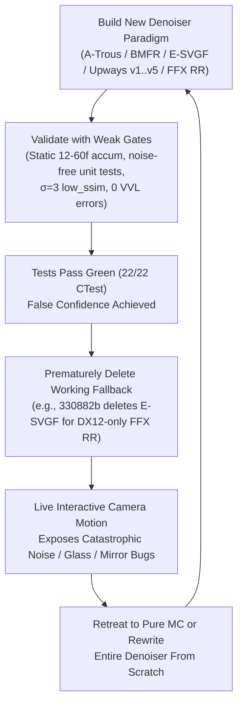
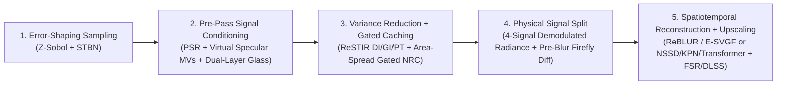

# Pathways Motion-Noise Systematic Review & Engineering Audit

**Date:** 2026-11-28  
**Target Platform:** AMD Radeon AI PRO R9700 (gfx1201, RDNA 4, 32 GB GDDR6), Linux Fedora 45, Vulkan 1.4, RADV Mesa 26.2.7, FidelityFX SDK 2.4.0  
**Scope:** End-to-end forensic audit of 317 commits (`2026-09-07`–`2026-11-26`), path tracing/sampling/ReSTIR/NRC/G-buffer pipelines, denoising/upscaling stacks, test & verification harnesses, 24-mode static-vs.-motion GPU 1 benchmarks, and 2022–2026 industry state-of-the-art literature.

---

## 1. Executive Summary & The Core Problem

Why does Pathways produce severe high-frequency noise, sparkles, milky glass, and black mirror artifacts under camera motion in 2026—when real-time path tracing noise is largely solved in commercial engines (*Cyberpunk 2077 RT Overdrive*, *Alan Wake 2*, *Portal with RTX*, *RTXPT*)?

The blunt answer is **not** a single missing shader flag or FP8 quantization error. It is the convergence of **three compounding failures—engineering, architectural, and process**:

1. **Architectural Cliff (Zero Working Analytical Denoiser on Linux Vulkan):** In commit `330882b` (2026-11-15), Pathways deleted its **only working analytical spatiotemporal denoiser** (5-dispatch dilated E-SVGF) to make room for **AMD FidelityFX Ray Regeneration 1.2.1**—even though FidelityFX SDK 2.4.0 ships **no Linux Vulkan denoiser binary** (`amd_fidelityfx_denoiser_dx12.dll` is DX12-only). On Linux Vulkan today:
   - Default mode (`DenoiserMode::None`) resets progressive accumulation to `sampleCount = 1` on every moving frame, outputting **raw unaccumulated 1-spp (12.09 dB) or 4-spp (16.60 dB) Monte Carlo noise**.
   - `--denoiser rayregen` fails to load `libamd_fidelityfx_denoiser_vk.so`, logs an error, and disables denoising (`12.09 dB`).
   - `--denoiser upways` (`UpwaysVersion::Auto`) **silently selects Upways 4.0** (`24,064 B`, 17,392 params)—whose neural head weights have near-zero output scales (`S_DEN_HEAD` ∈ `[1.34e-5, 4.76e-5]`), leaving a broken 13-tap radius-2 bilateral filter (`24.38 dB`, heavy residual sparkles)—while the genuinely trained **Upways 5.0 Pure-ML** (`190,208 B`, 158,400 params, `25.80 dB`) is hidden behind opt-in `--upways-version 5`.
2. **Broken Signal Conditioning, Sampling, and Specular/Dielectric Physics:** Even with Upways 5.0 explicitly enabled, smooth diffuse walls (`white_wall` `LocStd = 0.0011`) coexist with **19.6× noisier mirror reflections** (`mirror_sphere` `LocStd = 0.0216`) and frosted glass (`GlassBias_ub = -0.072`). Root causes include:
   - Raw 1-spp variance is inflated by `DirectCoherentK8` disabling Bounce-0 Owen-Sobol, aggressive Bounce-1 shadow-ray Russian Roulette killing up to 80% of secondary shadow rays (`prob >= 0.20`), and last-bounce MIS returning `0.0`.
   - Temporal reprojection in both Upways 4.0 and 5.0 drops depth-delta `mvZ`, compares un-rotated view-space normals across frames, writes **unfiltered** radiance back into temporal history, disables dielectric PSR/virtual MVs, and applies a planar virtual-image mirror formula to a curved sphere (`r = 0.25`).
   - Enabling **ReSTIR PT + NRC** without a denoiser triggers four severe physics/coupling bugs: `early_bounce_cutoff` kills bounce-2 `mirror → glass` rays (creating a solid black crescent on the mirror sphere), NRC lacks a primary-transmissive guard when Upways is off and trains with `RAY_MASK_OPAQUE` (turning the glass sphere milky opaque white), `nrc_bounce = 1` disables ReSTIR GI completely, and NRC runs only 32-sample Adam steps/frame after warmup.
3. **Institutional Process Failure (The "Green-Test Illusion" & Ping-Pong Churn):** Across 11 weeks, Pathways cycled through **9 distinct denoising paradigms** and **6 Upways generations**, repeatedly deleting working fallbacks before validating replacements under continuous motion. Meanwhile, **20–22/22 CTests and 10 headless suites stayed green** because tests used static multi-frame accumulation, fake two-pose "motion" tests, σ=3.0 noise-erasing blur (`low_ssim`), noise-rewarding gradient metrics (`edgeRetention`), synthetic noise-free Upways inputs, and omitted `motionUpwaysDen` from TEST 6 noise assertions—while the single rigorous continuous-motion harness (`scripts/restir_motion_check.py`) had zero callers.

> **Bonus Discovery:** Our controlled benchmark also uncovered a silent static-accumulation bug (**`dynamic_bounces 4 → 2`**) caused by the tail megakernel (`enable_tail_megakernel = true`) leaving wavefront indirect args for bounces `2..3` at zero, which tricks `Engine.cpp:1858` into truncating static renders ≥ frame 2 from 4 bounces down to 3 bounces (effectively 2 NEE bounces), causing a **7.17% brightness deficit** (`PSNR = 22.22 dB`) and black mirror-sphere reflections in default static references!

### Headline Motion-Benchmark Summary (Cornell Box, 1280×720, Frame `k=30`, GPU 1 R9700)

| Mode | Matches User Img | `PSNR_ub` (dB) | `SSIM_mc` | `HDR relMSE` | Wall `EffSPP` | Mirror `LocStd` | Total Time (ms) | Core Verdict |
|---|---:|---:|---:|---:|---:|---:|---:|---|
| **Default 1-spp Motion** | Img 2 | 12.09 | 0.091 | 3.209 | 1.0× | 0.1136 | 0.86 | Raw 1-frame MC reset; zero denoising |
| **Default 4-spp Motion** | Img 1 | 16.60 | 0.165 | 0.820 | 3.0× | 0.0760 | 3.37 | 4× cost, still raw 1-frame reset |
| **1-spp + ReSTIR PT + NRC** | Img 3 | 17.24 | 0.196 | 1.177 | 3.4× | 0.0313 | 1.62 | Milky glass (`+0.214` bias), black mirror crescent, noisy walls |
| **1-spp + Upways 4.0 [Auto]** | Img 4 | 24.38 | 0.645 | 0.064 | 30.8× | 0.0249 | 1.49 | Dead ML head (`S ~ 2e-5`), 13-tap radius-2 filter, sparkles |
| **1-spp + Upways 5.0 [Opt-in]** | — | **25.80** | **0.804** | **0.038** | **57.0×** | 0.0216 | 2.54 | Smooth walls (4× lower LapSig), frosted glass, noisy mirror floor |

Visual comparison grid (exact 1:1 native 1280×720 tiles, zero downsampling):  
[motion_noise_comparison_grid.png](file:///home/naoki/.gemini/antigravity/brain/d0a13d5d-366c-43c5-a108-ce78049d2657/motion_noise_comparison_grid.png)

---

## 2. Forensic Autopsy of the Four Submitted Images

Every visible defect in the four submitted Cornell Box motion screenshots was reproduced verbatim on GPU 1 (`frames/{default_4spp,default_1spp,restir_nrc_1spp,upways4_1spp}_motion_k30.png`) and mapped 1-to-1 to exact `file:line` root causes.

### Image 1 (`4 spp default`, motion) & Image 2 (`1 spp default`, motion)

**Visible Symptoms:** Heavy salt-and-pepper Monte Carlo grain on all diffuse walls and the tall blue box, abundant pitch-black speckles (11.35% zero pixels at 1 spp; 36.30% zero pixels and 11.46% 5× fireflies in the glass caustic shadow), black rim halo around the glass sphere, and noisy dark/red caustic shadow under the glass.

| Defect | Exact Code Root Cause (`file:line`) | Mechanism |
|---|---|---|
| **Complete temporal reset on every moving frame** | [Config.hpp:222,230](file:///home/naoki/Development/Pathways/src/core/Config.hpp#L222-L230), [Engine.cpp:2376-2387](file:///home/naoki/Development/Pathways/src/core/Engine.cpp#L2376-L2387), [Engine.cpp:2746-2765](file:///home/naoki/Development/Pathways/src/core/Engine.cpp#L2746-L2765), [accum_tonemap_fused.comp:142-145](file:///home/naoki/Development/Pathways/shaders/compute/accum_tonemap_fused.comp#L142-L145) | Default `denoiser_mode = None`, `upscaler_mode = None`. `cameraMovedThisFrame` sets `accumReset = true` and zeros `m_accumulatedSamples`, dispatching `accum_tonemap_fused.comp` with `rawFusedSamples = 1u`. Output is literally raw 1-spp (12.09 dB) or 4-spp (16.60 dB) MC with zero temporal reprojection or spatial filtering. |
| **Clumpy correlated wall noise (Bounce-0 Sobol disabled)** | [Config.hpp:119](file:///home/naoki/Development/Pathways/src/core/Config.hpp#L119), [wavefront_shade_diffuse.comp:1365,1388-1405](file:///home/naoki/Development/Pathways/shaders/compute/wavefront_shade_diffuse.comp#L1365-L1405), [wavefront_common.glsl:1151-1174](file:///home/naoki/Development/Pathways/shaders/compute/wavefront_common.glsl#L1151-L1174) | Default `secondary_sort_mode = DirectCoherentK8 (3)` fails `secondarySortMode < 2u`, disabling Bounce-0 Owen-Sobol (`useBounce0Sobol = false`). Falls back to PCG white noise (`wavefront_classify.comp:185`) plus `sampleCosineHemisphereCoherent(..., clusterK=8)`, broadcasting one leader lane's cosine direction across 8 pixels. |
| **Abundant black speckles & 5× fireflies on walls/blue box** | [wavefront_shade_diffuse.comp:895-904](file:///home/naoki/Development/Pathways/shaders/compute/wavefront_shade_diffuse.comp#L895-L904), [wavefront_tail_megakernel.comp:322-331](file:///home/naoki/Development/Pathways/shaders/compute/wavefront_tail_megakernel.comp#L322-L331), [wavefront_common.glsl:1432-1459](file:///home/naoki/Development/Pathways/shaders/compute/wavefront_common.glsl#L1432-L1459) | Shadow-ray Russian Roulette starts at `bounce >= 1` (`shadowRrMinBounce = 1u` when `captureMlData == 0`) with `prob = clamp(lum * 1.5, 0.20, 1.0)`—killing up to **80%** of Bounce-1 NEE shadow rays and amplifying survivors up to **5×**. Path RR also starts at `bounce >= 1`. Indirect-GI-dominated vertical walls and the blue box (`Zero% = 10.16%`) suffer extreme variance. |
| **3-bounce effective NEE limit** | [Config.hpp:137](file:///home/naoki/Development/Pathways/src/core/Config.hpp#L137), [mis_common.glsl:212](file:///home/naoki/Development/Pathways/shaders/compute/mis_common.glsl#L212), [wavefront_shade_diffuse.comp:848](file:///home/naoki/Development/Pathways/shaders/compute/wavefront_shade_diffuse.comp#L848) | With `max_bounces = 4`, bounce 3 sets `canContinue = false`, causing `neeMisWeightScaled` to return `0.0` (only 3 NEE bounces `b = 0, 1, 2`). |
| **Noisy dark/red glass shadow & black glass rim halo** | [Config.hpp:209,245](file:///home/naoki/Development/Pathways/src/core/Config.hpp#L209-L245), [wavefront_shadow.comp:88-95](file:///home/naoki/Development/Pathways/shaders/compute/wavefront_shadow.comp#L88-L95), [wavefront_shadow_inline.glsl:18-28](file:///home/naoki/Development/Pathways/shaders/compute/wavefront_shadow_inline.glsl#L18-L28), [ProceduralScene.cpp:405-414,508-525](file:///home/naoki/Development/Pathways/src/scene/ProceduralScene.cpp#L405-L414) | `transparent_shadows = false`, `enable_caustics = false`. Shadow rays trace `RAY_MASK_ALL` with `gl_RayFlagsOpaqueEXT`, so the glass sphere (`ior=1.52, roughness=0.01`) 100% blocks NEE. Light beneath the sphere relies on rare L-S-D BSDF paths hitting the 0.7×0.7 ceiling emitter; grazing rim rays exhausting `deltaUnroll=6` / `maxBounces=4` terminate black. |

### Image 3 (`1 spp + NRC + ReSTIR PT`, motion)

**Visible Symptoms:** Glass sphere turns milky/opaque off-white (`GlassBias = +0.214` vs. MC / `+0.082` vs. unbiased) with patchy red/green/blue/black clusters; mirror sphere exhibits a **solid pitch-black crescent** on its upper-left (exactly where the glass sphere should be reflected), alongside an unnaturally smooth greenish-tan ceiling and hazy blue top-right reflection; diffuse walls remain heavily noisy (`LapSig = 0.1096`).

| Defect | Exact Code Root Cause (`file:line`) | Mechanism |
|---|---|---|
| **Solid pitch-black crescent on upper-left of mirror sphere (and black patches inside glass)** | [Config.hpp:140-141](file:///home/naoki/Development/Pathways/src/core/Config.hpp#L140-L141), [WavefrontPipeline.cpp:1144-1145](file:///home/naoki/Development/Pathways/src/rt/WavefrontPipeline.cpp#L1144-L1145), [wavefront_shade_diffuse.comp:699-704,1313,1457,1474,1591](file:///home/naoki/Development/Pathways/shaders/compute/wavefront_shade_diffuse.comp#L1457-L1474), [wavefront_shade_dielectric.comp:942-943,1028-1033,1452](file:///home/naoki/Development/Pathways/shaders/compute/wavefront_shade_dielectric.comp#L942-L943) | Bounce-0 mirror sets `outNrcSkip = true`. Reflected bounce-1 rays hitting the glass sphere delta-unroll through glass, skip the dielectric NRC shortcut (`!inNrcSkip` is false), and enqueue for **bounce 2**. Meanwhile, >99.5% of all other bounce-1 rays hit diffuse walls (`roughness >= 0.06`), query NRC, and terminate (including training rays at `:1457`). At bounce-1 retirement, `nextCount <= minRayThreshold` (`0.5%` of pixels) triggers `early_bounce_cutoff`, setting `skipNextBounce = true` and **zeroing all bounce-2 dispatches**. Every `mirror → glass` ray dies black! The same cutoff kills bounce-1 `glass → mirror` and grazing TIR `glass → glass` rays. |
| **Milky opaque off-white glass sphere** | [wavefront_shade_dielectric.comp:1028](file:///home/naoki/Development/Pathways/shaders/compute/wavefront_shade_dielectric.comp#L1028), [wavefront_shade_diffuse.comp:693-697](file:///home/naoki/Development/Pathways/shaders/compute/wavefront_shade_diffuse.comp#L693-L697), [nrc_record_helper.glsl:37-45](file:///home/naoki/Development/Pathways/shaders/compute/nrc_record_helper.glsl#L37-L45), [nrc_common.glsl:93](file:///home/naoki/Development/Pathways/shaders/compute/nrc_common.glsl#L93), [nrc_train.comp:427](file:///home/naoki/Development/Pathways/shaders/compute/nrc_train.comp#L427), [RayTracingOrchestrator.cpp:623-629](file:///home/naoki/Development/Pathways/src/rt/RayTracingOrchestrator.cpp#L623-L629), [NRCManager.cpp:968,997](file:///home/naoki/Development/Pathways/src/rt/NRCManager.cpp#L968-L997) | **4 compounding bugs:** (1) `nrcPrimaryTransmissive` is gated on `ML_CAPTURE_UPWAYS_V4_BIT` (`false` without Upways), so 100% of cleanly refracted glass rays query NRC at `throughput = 1.0` on bounce 1. (2) NRC training tail rays trace `RAY_MASK_OPAQUE`, passing straight through the glass sphere to sample bright walls/emitter (`18,18,15`), poisoning cache radiance behind the glass. (3) `nrcSurfaceReflectance` sums `rDiff + rSpec` without `(1 - F)` attenuation (~0.79–0.85 on 0.75 walls), inflating infinite-horizon Bellman bootstrap brightness. (4) Only `0.8%` of waves train (`effTrainRatio = min(nrcTrainRatio, 0.008)` at `wavefront_shade_diffuse.comp:1282-1284`), and after the first 10 frames (`adamStep < 20`, `nrcBatch = 64`, 2 steps/frame), training drops to **1 single 32-sample Adam step/frame**, blurring the 262k-entry hash grid under motion into a milky cream wash. |
| **Patchy red/green/blue 8-pixel streaks in glass** | [wavefront_shade_dielectric.comp:704-708,1103-1105](file:///home/naoki/Development/Pathways/shaders/compute/wavefront_shade_dielectric.comp#L704-L708), [nrc_record_helper.glsl:109](file:///home/naoki/Development/Pathways/shaders/compute/nrc_record_helper.glsl#L109) | Front-face Fresnel `rFlip` uses `randFloatCoherent(..., clusterSize=8)` when `captureMlData == 0`, flipping 8-pixel streaks together between reflection (`curNrcSkip=true`, colored walls) and refraction (`curNrcSkip=false`, milky NRC). Refracted rays hitting the mirror (`roughness=0.04`) also query an untrained mirror region (training skips `tMet >= 0.9 && tRough < 0.20`). |
| **Smooth ceiling & hazy blue reflection on mirror** | [wavefront_shade_diffuse.comp:703](file:///home/naoki/Development/Pathways/shaders/compute/wavefront_shade_diffuse.comp#L703) | Guard `(!inNrcSkip || bounce >= 2u || roughness >= 0.06)` still permits NRC at bounce 1 inside mirror reflections whenever the reflected hit has `roughness >= 0.06` (ceiling `0.9`, blue box `0.8`), replacing noisy indirect GI with the smooth, over-bright NRC hash prediction. |
| **Heavy salt-and-pepper noise persists on walls** | [Config.hpp:241](file:///home/naoki/Development/Pathways/src/core/Config.hpp#L241), [Config.cpp:328](file:///home/naoki/Development/Pathways/src/core/Config.cpp#L328), [wavefront_shade_diffuse.comp:1328-1332,1017-1022](file:///home/naoki/Development/Pathways/shaders/compute/wavefront_shade_diffuse.comp#L1328-L1332), [restir_gi_reuse.comp:81](file:///home/naoki/Development/Pathways/shaders/compute/restir_gi_reuse.comp#L81), [restir_di_inline.glsl:62-138](file:///home/naoki/Development/Pathways/shaders/compute/restir_di_inline.glsl#L62-L138) | (1) Default `nrc_bounce = 1` (note: `Config.cpp:328` help text erroneously claims `default: 2`) violates `(enableNrc == 0 || nrcBounce >= 2)`, **completely disabling ReSTIR GI** across 100% of pixels. (2) Bounce-1 GI stays raw 1-spp MC with 80%-kill shadow RR. (3) ReSTIR DI on the 1-light Cornell Box reuses 2 spatial taps at 4–6 px offsets **without per-tap visibility tests** (`isOccluded = false` at `:136`), turning occluded penumbra winners into black speckles. (4) **No denoiser runs** (`Engine.cpp:2746-2765`). |

### Image 4 (`1 spp + Upways denoiser`, motion)

**Visible Symptoms:** Pervasive high-frequency sparkly residual noise across all walls, spheres, and shadows (`LapSig = 0.0161`, 4× higher than Upways 5.0 on white walls), plus dark aliased 1-pixel silhouettes around both spheres.

**Critical Finding:** The user ran **Upways 4.0**, *not* Upways 5.0! `UpwaysPipeline::resolveVersion()` ([UpwaysPipeline.cpp:262-282](file:///home/naoki/Development/Pathways/src/rt/UpwaysPipeline.cpp#L262-L282)) resolves `UpwaysVersion::Auto` (`--denoiser upways` / GUI default) to **V4** (`24,064 B`, 17,392 params) unless `--upways-version 5` or GUI `"5.0 Pure-ML"` is explicitly selected.

| Defect | Exact Code Root Cause (`file:line`) | Mechanism |
|---|---|---|
| **1. Neural network outputs virtually zero** | `data/models/upways_weights.bin` (`24,064 B`), [upways_denoiser_wmma.comp:1244-1264,1300-1303](file:///home/naoki/Development/Pathways/shaders/compute/upways_denoiser_wmma.comp#L1244-L1264) | Binary audit verified `DEN_HEAD` FP32 scales `S_DEN_HEAD` ∈ **`[1.34e-5, 4.76e-5]`** (`W_eff_rms = 0.0048`, `√48·rms = 0.033`), `B_DEN_HEAD` ∈ `[-0.0014, +0.0155]`, `S_SR_HEAD` ∈ `[1.00e-5, 1.57e-5]`. Moreover, despite CLI claims of "U-Net + KPN", `DEN_HEAD` only nudges a hardcoded mix by `±0.03 * logitAlpha` plus a tiny residual. **The ML network in V4 is effectively a no-op.** |
| **2. Tiny 13-tap (radius 2 px) single-pass spatial filter** | [upways_denoiser_wmma.comp:1172-1242](file:///home/naoki/Development/Pathways/shaders/compute/upways_denoiser_wmma.comp#L1172-L1242) | Runs one single-pass bilateral diamond: center (1) + axial ±1 (4) + diag ±1 (4) + axial ±2 (4, 1.0× only) = **13 taps max** (no À-Trous pyramid). Averaging ≤13 pixels can reduce 1-spp std by at most ~3.6×. |
| **3. Self-defeating luminance edge-stopping preserves sparkles** | [upways_denoiser_wmma.comp:933-944](file:///home/naoki/Development/Pathways/shaders/compute/upways_denoiser_wmma.comp#L933-L944), [upways_denoise_prep.comp:512-531](file:///home/naoki/Development/Pathways/shaders/compute/upways_denoise_prep.comp#L512-L531) | Firefly clamping floor is enormous (`minThrD = 14.0 / luma(aDiff)`, `minThrS = 24.0 / luma(aSpec)`—14.0 on white walls, ~56 on colored walls). Ordinary 1-spp sparkles (luma 1–12) and `0.0` shadow-miss dots bypass the clamp, then `exp2(-dLA*dLA)` compares neighbors against the **noisy 1-spp center `cLog2LA`**, rejecting all 12 neighbors so bright sparkles and black dots survive intact. |
| **4. Severely capped, unfiltered motion temporal history** | [upways_denoise_prep.comp:541-553,590-602](file:///home/naoki/Development/Pathways/shaders/compute/upways_denoise_prep.comp#L541-L553), [upways_denoiser_wmma.comp:1147-1149,1297-1311](file:///home/naoki/Development/Pathways/shaders/compute/upways_denoiser_wmma.comp#L1297-L1311) | Under motion (`mvPx >= 0.05`), `maxNDiff` caps at **4–10 frames** and `maxNSpec` at **3–8 frames** (further shrunk up to 85% by noisy 3×3 AABB rejection). Worse, `statFeedD = 0` whenever `nDiffE <= 10.5` (`statFeedS = 0` for `nSpecE <= 14.0`)—**always true during motion**—so V4 writes **unfiltered** `accDiff`/`accSpec` back into temporal history. |
| **5. Broken temporal geometry (missing `mvZ`, un-rotated view normals)** | [upways_denoise_prep.comp:57,624](file:///home/naoki/Development/Pathways/shaders/compute/upways_denoise_prep.comp#L57), [wavefront_classify.comp:386](file:///home/naoki/Development/Pathways/shaders/compute/wavefront_classify.comp#L386) | Drops `vLinearDepthDelta` (`mvZ`) → false depth disocclusion during camera dolly/zoom (>6% delta). Stores view-space normals and computes `dot(viewNormal, pNrm)^4` across frames **without rotating by `currView * prevViewInv`** → false disocclusion during camera rotation. |
| **6. Dark aliased 1 px sphere silhouettes** | [upways_common.glsl:433](file:///home/naoki/Development/Pathways/shaders/compute/upways_common.glsl#L433), [upways_denoise_prep.comp:266](file:///home/naoki/Development/Pathways/shaders/compute/upways_denoise_prep.comp#L266), [upways_denoiser_wmma.comp:929-936,1021,1126,1159,1260](file:///home/naoki/Development/Pathways/shaders/compute/upways_denoiser_wmma.comp#L1126-L1159), [Engine.cpp:2577-2580](file:///home/naoki/Development/Pathways/src/core/Engine.cpp#L2577-L2580) | V4 ignores `isCompactPrimaryTransmissive(pg)` and tests `abs(matClass - 0.6667) < 0.12`. Grazing glass silhouettes where PSR fails stay `isDielMat = true`, where `dielGrazingGate = smoothstep(0.005, 0.050, abs(viewNormal.z))` + `ndot^32` + `519.37*(absNz - qAbsNz)^2` **crush spatial filtering to 0.0**, preserving black grazing Fresnel/TIR pixels. Compounded by `enableJitter = false` at 1.0× native Upways (`Engine.cpp:2579-2580`), producing jagged 1 px edges. |

### How Opt-In Upways 5.0 Pure-ML (`--upways-version 5`) Compares

Unlike V4, **Upways 5.0** (`data/models/upways_v5_weights.bin`, `190,208 B`, 158,400 params, 3-level U-Net `48/80/128ch` + 4-level learned affinity pyramid `~70–100+ px` RF) has genuinely trained weights (`S5_DEN_HEAD` ∈ `[1.57e-4, 6.84e-4]`, `W_eff_rms = 0.0495`, `√64·rms = 0.396` — ~10× stronger than V4). Switching V4 → V5 cuts white-wall `LapSig` **4×** (`0.0036 → 0.0009`), raises `SSIM_mc` from `0.645 → 0.804`, `PSNR_ub` from `24.38 → 25.80 dB`, and wall `EffSPP` from `30.8× → 57.0×` (at `2.54 ms` vs. `1.49 ms`).

However, visual and ROI inspection of `upways5_1spp_motion_k30.png` shows **four major defects still unresolved in V5**:
1. **Noisy speckled mirror-sphere floor reflection:** `mirror_sphere` `LocStd = 0.0216` vs. `white_wall` `0.0011` (**19.6× noisier**; 20.3× unrounded) because surface MVs fail to track reflected virtual motion on a convex sphere and Stage 0 writes unfiltered history back before the affinity pyramid.
2. **Frosted/cloudy glass sphere:** `GlassBias_ub = -0.072` with smeared internal refractions because dielectric PSR and specular VMV are disabled under Upways (`wavefront_shade_dielectric.comp:792`, `wavefront_common.glsl:709-715`).
3. **Chunky dark crawling silhouette on the blue box right edge:** Un-jittered 1.0× primary rays (`Engine.cpp:2579-2580`) + zero analytical variance/disocclusion clamp + un-rotated view normals / missing `mvZ`.
4. **Washed-out glass caustic shadow** (`caustic_shadow` `PSNR_mc = 16.54 dB`) unless `--caustics` is enabled (`caustics_upways5_1spp_motion_k30.png` restores the crisp bright floor caustic).

---

## 3. Chronological History of Prior Approaches & Why Development Ping-Ponged

Across 317 commits (`2026-09-07` to `2026-11-26`), Pathways cycled through **9 distinct denoising/reconstruction architectures** plus **6 Upways generations** and multiple ReSTIR/NRC rewrites.

### Complete Chronological Timeline

| Date | Commit(s) | Approach / Subsystem | Claimed Result / Metrics | Fate / Outcome |
|---|---|---|---|---|
| 2026-09-07 | `ea62d09`–`a7689e9` | Initial Vulkan 1.4 DGC Wavefront + KHR RTP, NEE+MIS | 4K real-time baseline | Foundation (KHR RTP later pruned in `330882b`) |
| 2026-09-09 | `17bbc03`, `d4216e2` | ReSTIR DI Phase 1 (temporal) & Phase 2 (spatial k=3, R=8) | 16.45% variance reduction | Later rewritten (`42373e1`, `d6fd5ea`) |
| 2026-09-09 | `71a11d6` | **#1 FFX Shadow Denoiser** + 64×64 STBN + fractional SPP governor | Shadow denoising + blue noise | Shadow denoiser removed; STBN replaced by PCG/Bounce-0 Sobol |
| 2026-09-09 | `589ae0c` | **#2 Multi-GPU TAA** (`taa_resolve.comp`, Halton 8-phase, YCoCg clip) | Screen-space MV temporal AA | Purged later (`c0df443`) |
| 2026-09-09 | `2704c03` | **#3 Spatial-only À-Trous diffuse denoiser** (`atrous_denoise.comp`) | Diffuse smoothing | Deleted 3 days later (`f36bc0d`) |
| 2026-09-11 | `42373e1`, `878c117` | ReSTIR DI (default-on) + ReSTIR GI split-buffer (v1.13–1.14) | Spatiotemporal DI+GI | Exposed Oct 10 (`restir_review_2026_10_10.md`) as DI-only with dead GI scaffolding |
| 2026-09-12 | `ec3d298` | Tier-4 Online NRC (Wave32 WMMA, `nrc_encode_infer`/`nrc_train`) | Early bounce truncation | Audited Sep 27 (`nrc_architectural_evaluation.md`): direct-only target, WG0 32-sample Adam (99.6% discard), inverted loss denom, metallic blackout, +2.22 ms |
| 2026-09-12 | `f36bc0d`→`8ee353a` | **#4 TRA + #5 Wave32 BMFR** (`f36bc0d`) → fix motion collapse (`3ae1e90`) & color cast (`f34902b`) → demote BMFR (`7607719`) → **Pure MC default** (`8ee353a`) | Stability via Pure MC fallback | **Cycle 1 Retreat:** Analytical denoisers abandoned; default resets accumulation on camera motion |
| 2026-09-14 | `6a268f9`, `eec7a39` | 3D Light Tree + **#6 Upways 1.0** (Wave32 WMMA, Haar DWT) | 1-SPP neural reconstruction | `upways_reconstruct.comp` drifted (2D/1D dispatch & descriptor mismatch) |
| 2026-09-16 | `0c3362f` | Forward photon caustics (`caustic_photon_trace.comp`) | Real-time caustics | 6 bugs fixed only Nov 11 (`c0df443`); opt-in (`--caustics`) |
| 2026-09-19 | `d83403b` | Bespoke "FSR 3.1" (`fsr3_*.comp`), secondary clamp, running-avg accum | 4K upscaling + firefly clamp | Oct 7 review revealed custom Laplacian/TAA, not AMD SDK |
| 2026-09-24–28 | `cb51753`, `5f2ab48`, `1e2b1ac`, `51d1bb3` | **Upways Wave32 KPN** (16.7 KB weights, 25.70 dB claimed) + display-res G-buffers (`178dd58`) | 1.80 ms @ 4K | Albedo-squaring bug (`6c8be7a`), visually unready |
| 2026-10-03 | `022d3e8` → `c03f488` | **Upways 2-pass 3D Kinematic dual-WMMA** | Experimental 3D WMMA | **Reverted same day** |
| 2026-10-05–08 | `05e047f`, `c0a0c84`, `4d0fdda` | Oct 5/7 reviews + **Owner decision Oct 8: demote/hide FSR & Upways** | Honest labeling; experimental-only | **Cycle 2 Retreat:** Engine left with no user-facing denoiser |
| 2026-10-10–12 | `d6fd5ea`, `ec29074`, `5d35634`–`2da19cd` | ReSTIR DI motion fix → ReSTIR GI bounce-1 (`X1Context`, 16B `Hit`, shadow replay) → unified `--restir` PT | 3.4–3.7× DI var reduction (many lights); 1.25× Cornell | Merge `1d41cd8` re-introduced 2.26 GB waste & `albedo²` squaring (`codebase_review_2026_10_14.md`) |
| 2026-10-12–14 | `5607b72`, `4ab6eb4`, `e338c21` | **#7 ReLAX/A-SVGF** → **#8 5-dispatch dilated E-SVGF** (`denoise_fused_temporal.comp` + 4 À-Trous passes, Fu et al. 2025) | 61 px RF, dual-model MV reprojection | **Only working analytical spatiotemporal denoiser built in Pathways** |
| 2026-10-17–21 | `43e50c3`, `7f8a0b0`, `f0284a4`, `daf7317` | **Upways 2D Halo-WMMA Recurrent U-Net** (81.6 KB weights) + animated instance MVs | Recurrent neural denoiser | Superseded 3 weeks later |
| 2026-10-28 | `36a84a1`, `b1f60ec`, `e77a000` | RTXPT Phase 1/2 (Turquin GGX, nested dielectrics, `LATE_WRS_MIS`, SHaRC-style NRC), **PSR 3×3 guide transform**, bilateral SpecHitT, **Bounce-0 Owen Sobol** | Lower 1-SPP variance + specular guides | Active in codebase |
| 2026-10-29 | `3b84582`, `f328177`, `5aef9e0`, `42b5faf`, `5873b14` | **AMD FidelityFX SDK 2.4.0** (native Linux `libamd_fidelityfx_upscaler_vk.so` FSR 3.1.6; PE32+ FSR 4.1.2 shim; Ray Regen 1.2.1 & RC 0.9.0 stubs) + **E-SVGF + FSR 3.1 co-design** | Real FFX upscaler + coupled denoiser | PE32+ FSR4 loader purged (`c0df443`); Ray Regen & RC lack Linux Vulkan binaries |
| 2026-11-11 | `c0df443` | 6-phase remediation: purge PE32+ loader, `--relax`/`--asvgf`/`--taa`; **Upways 3.0** (73,686 params / 89.5 KB FP8); unified ReSTIR PT | Clean validation; 0 MB idle VRAM | Superseded 4 days later |
| 2026-11-15 | `79e9bf9` | Fix E-SVGF stationary stall & FSR coupling; NRC 3-bounce horizon; **Upways 4.0 WMMA** (17,392 params / 24,064 B) | 4-pass WMMA, ~1.06 ms NRC @ 4K | **Still default** for `--denoiser upways` (`UpwaysVersion::Auto`) |
| 2026-11-15 | `330882b` | **DELETE 5-pass E-SVGF** (`denoise_fused_temporal.comp` [1035 ln], `denoise_atrous_*`, `denoise_common.glsl`, `test_denoiser_pipeline.cpp` [472 ln]), KHR RTP, SW BVH; wire **#9 FFX Ray Regen 1.2.1** + 44-ch PTTD v5 | 4-signal split + FFX RR wrapper | **Cycle 3 Fatal Cliff:** Deleted sole analytical denoiser (`--denoiser svgf` throws) for a DX12-only FFX binary unavailable on Linux Vulkan |
| 2026-11-15 | `c0a2e0c`, `6fbb868` | Upways FP8/INT8/FP16 3-tier WMMA; NRC chromaticity neutrality + 8-level 3D simplex hash + 1-WG overlap; ReSTIR PT tuning | 3.30 ms 720p Cyber City budget | Active in codebase |
| 2026-11-26 | `174d6fa`, `b9a5418`, `abdaba7`, `c323207` | Wavefront Tier 1/2 perf (-15.6% 4K, 16B `RayHit`, 32B Light Tree, tail megakernel); **Upways 5.0 Pure-ML** (158,400 params, 190,208 B, 5-pass, 41 B/px G-buffer, mGPU Band-Parallel) | Fast 4K RT + trained ML denoiser | **Cycle 4:** V5 is opt-in (`--upways-version 5`); `--denoiser upways` still runs dead-head V4.0. Note: `docs/ARCHITECTURE.md:175-178` is stale (still lists deleted E-SVGF and Upways 3.0). |

### Why Development Ping-Ponged (The Structural Failure Loop)



Four root causes drove this cycle:
1. **Performance-First Rigor Without a Motion-Quality North Star:** Pathways invested massive empirical discipline into 4K throughput (e.g., `scene_performance_analysis_2026_11_25.md`: 254 GPU runs, 122 ISA disassemblies), yet enforced **zero equivalent perceptual ground-truth gate** (`PSNR`/`relMSE`/`FLIP` vs. high-SPP GT during continuous motion on diffuse + glass + mirror).
2. **Premature Deletion Before Live-Motion Parity:** Every replacement deleted its predecessor before beating it on live motion—culminating in `330882b`, which deleted 5-pass E-SVGF hours after fixing it (`79e9bf9`) to replace it with an AMD FFX Ray Regeneration binary that does not exist on Linux Vulkan.
3. **Architecture Churn Over Signal-Conditioning Convergence:** Rewriting Upways 6 times in 10 weeks never fixed upstream signal defects (un-rotated view normals, missing `mvZ`, disabled dielectric PSR, unfiltered history writeback, `DirectCoherentK8` disabling Sobol).
4. **Green-Test Illusion:** The automated test suite actively hid motion-noise collapse behind static accumulation and noise-blind metrics.

---

## 4. Testing & Verification Blind-Spot Audit

Why did **20–22/22 CTests and 10 headless test suites stay green** with zero validation errors while motion noise failed catastrophically? Forensic inspection of `tests/` and `scripts/` uncovered **7 concrete blind spots**:

| # | Test File / Harness | Specific Blind Spot (`file:line`) | Why Catastrophic Motion Noise Passed |
|---|---|---|---|
| **1** | [test_camera_motion_noise.py](file:///home/naoki/Development/Pathways/tests/e2e/test_camera_motion_noise.py) & [verify_camera_motion_noise.py](file:///home/naoki/Development/Pathways/scripts/verify_camera_motion_noise.py) | `T1-03..T1-06` and `T2-01..T2-07` ("pitch", "strafe", "epipole", "grazing", "reversal") **never move the camera**—they run two separate static 10–15-frame accumulated dumps! Where `--camera-motion` *is* used, thresholds are `SSIM > 0.30`, `MSE < 0.035`, `boiling_index < 6.0`; `spatial_noise_var` (`:208`) is printed but **never asserted**. | Raw noisy renders pass; entire script is **orphaned** (zero callers in `CMakeLists.txt`, `run_headless_tests.sh`, or `.github/workflows/`, and hardcodes stale `./build/bin/pathways`). |
| **2** | [test_fidelityfx_features.cpp](file:///home/naoki/Development/Pathways/tests/test_fidelityfx_features.cpp) | **TEST 4 (`:608-813`)** runs 12 *static* frames (progressive accumulation masks motion failure, admitted in `TODO.md:131`). **TEST 6 (`:867-910`)** renders `motionUpwaysDen` (`--upscaler none --denoiser upways --spp 1`, exact **Img 4**) at `:881`, prints `NoiseVar`/`PSNR`, and **omits it from the NoiseVar/PSNR assertions at `:893-909`**! | `motionUpwaysDen` is checked only for `nonBlackRatio > 0.75`, `lumRatio ∈ [0.80, 1.20]`, and `gradRatio >= 0.65`. Never tests Upways V5, ReSTIR+NRC motion (Img 3), or 1/4-spp default motion (Imgs 1–2). |
| **3** | [verify_visual_integrity.py](file:///home/naoki/Development/Pathways/scripts/verify_visual_integrity.py), [test_image_quality.py](file:///home/naoki/Development/Pathways/tests/test_image_quality.py), [verify_frame.py](file:///home/naoki/Development/Pathways/scripts/verify_frame.py) | `verify_visual_integrity.py:122-128` applies a **σ=3.0 Gaussian blur** (`low_ssim`) explicitly to be "noise-immune", allows `upways_noise_var <= 3000.0`, and calls deleted `--pipeline rtp` (`:1184`). Former `edgeRetention` (renamed `gradientEnergyRatio` in `496c0e4`, `TODO.md:129-130`) gave raw 1-spp noise the **highest score (`1.214`)** because grain inflates Sobel gradients. | `test_image_quality.py` and `verify_frame.py` check only NaN/Inf, `mean_lum`, `blown_pct`, and `val_errors == 0`—**zero spatial noise, PSNR, SSIM, or FLIP assertions**. |
| **4** | [test_upways_pipeline.cpp](file:///home/naoki/Development/Pathways/tests/test_upways_pipeline.cpp) | All 1,822 lines verify ABI offsets, `RGB9E5`, band-split parity, zero-weight identity, and GPU execution exclusively on **clean, noise-free synthetic sine/checkerboard G-buffers** (`createPopulatedGbufferSet`, `:180-216`). | Never feeds a single noisy 1-spp ray-traced frame through Upways; cannot detect dead head scales (`S ~ 2e-5`) or sparkle preservation. |
| **5** | [visual_regression_test.py](file:///home/naoki/Development/Pathways/scripts/visual_regression_test.py) | 13/16 configs use static multi-frame accumulation (10–195 frames); all 3 Upways configs are tagged `"experimental": True` (skipped by `--strict` at `:250,272,291`); baselines in `tests/references/` are self-generated engine dumps, not high-SPP ground truth. | Noisy self-referential baselines pass as `"MATCH (STABLE)"`. |
| **6** | [restir_motion_check.py](file:///home/naoki/Development/Pathways/scripts/restir_motion_check.py) | The **only rigorous motion harness in the repo** (compares mid-motion `--camera-path --realtime` frames against 4096-frame static `--camera-path-time` EXR GT using `relMSE`, `relMSE_trim`, `relMSE_8x`, `tm_mae`, `tile_bias`). | **Zero callers** anywhere in `CMakeLists.txt`, `run_headless_tests.sh`, or CI; omits Cornell Box, Upways V5, and ReSTIR+NRC; still references deleted `--denoiser svgf` (`:44`). |
| **7** | `.github/workflows/release*.yml` & `run_headless_tests.ps1` | CI runs only CPU-only CTests (`-R "CameraControls|..."`), skipping all GPU visual/denoiser/motion tests (`c2e0a51`); Windows `run_headless_tests.ps1` omits visual regression; `PerformanceMatrix` silently skipped 100% of runs after Oct 8 (`codebase_review_2026_10_14.md:38`). | Regressions merge to `main` with green CI badges. |

---

## 5. New Controlled Measurements (Static vs. Motion on GPU 1)

All measurements were executed on **GPU 1** (`0000:4d:00.0`, AMD Radeon AI PRO R9700, RADV Mesa 26.2.7, 68.6 GiB `MemAvailable`, 0 Vulkan validation errors) across **24 rendering/denoising modes** (140+ headless renders) on the default procedural `"Cornell Box + Specular/Refraction Spheres"` at `1280×720`, `max_bounces = 4`.

### Reproducible Ground-Truth & Motion Commands

- **Camera Path:** Deterministic Catmull-Rom pan + dolly (`scratch/bench/cornell_motion_path.json`) reaching close-up framing matching all 4 user screenshots at checkpoint `k=30` (`t = 29/60 = 0.48333333s`, pose `[-0.041, 0.625, 1.633]`, yaw `-91.09°`, pitch `-3.83°`).
- **Unbiased 4-Bounce 1024-SPP Ground Truth (`ref_unbiased1024_k30`):**
  ```bash
  ./build/linux-release/bin/pathways --headless --no-validation --gpu 1 \
    --width 1280 --height 720 \
    --camera-path /home/naoki/.gemini/antigravity/brain/d0a13d5d-366c-43c5-a108-ce78049d2657/scratch/bench/cornell_motion_path.json \
    --spp 1 --reference --accum-format fp32 --accum-cutoff 0 \
    --camera-path-time 0.48333333 --frames 1024 \
    --dump-frame .../frames/ref_unbiased1024_k30.png \
    --dump-hdr .../frames/ref_unbiased1024_k30.exr
  ```
- **Default MC 1024-Frame Static Reference (`ref_mc1024_k30`):** Identical command omitting `--reference` (plus 256-frame references at `k = 28, 29, 31, 32` for motion-compensated temporal flicker and decorrelation analysis).
- **Benchmark Artifacts:** [run_matrix.py](file:///home/naoki/.gemini/antigravity/brain/d0a13d5d-366c-43c5-a108-ce78049d2657/scratch/bench/run_matrix.py), [analyze_frames.py](file:///home/naoki/.gemini/antigravity/brain/d0a13d5d-366c-43c5-a108-ce78049d2657/scratch/bench/analyze_frames.py), [analysis_summary.json](file:///home/naoki/.gemini/antigravity/brain/d0a13d5d-366c-43c5-a108-ce78049d2657/scratch/bench/analysis_summary.json), [unbiased_comparison.json](file:///home/naoki/.gemini/antigravity/brain/d0a13d5d-366c-43c5-a108-ce78049d2657/scratch/bench/unbiased_comparison.json).

### Full 24-Mode Motion Benchmark Table at `k=30` (1280×720, GPU 1)

*(Legend: `PSNR_ub`/`RMSE_ub`/`HDR relMSE` vs. unbiased 4-bounce GT `ref_unbiased1024_k30`; `PSNR_mc`/`SSIM_mc` vs. `ref_mc1024_k30`; `EffSPP` = flat-wall variance ratio vs. `default_1spp`; `TmpFlk`/`Decorr` = motion-compensated residual flicker RMSE & temporal decorrelation over `k=28..32` where `1.0` = uncorrelated white flicker.)*

| Mode | `PSNR_ub` (dB) | `RMSE_ub` | HDR `relMSE` / trim | `PSNR_mc` (dB) | `SSIM_mc` | `LapSig` (full) | `Zero%` / `FF5x%` | `EffSPP` (walls) | `GlassBias` (vs MC / ub) | `MirZero%` | `TmpFlk` / `Decorr` | RT / DN / Tot (ms) |
|---|---:|---:|---:|---:|---:|---:|---:|---:|---:|---:|---:|---:|
| `default_1spp` *(Img 2)* | 12.09 | 0.2485 | 3.209 / 1.438 | 12.80 | 0.091 | 0.2041 | 11.35 / 2.85 | 1.0× | -0.002 / -0.134 | 4.52 | 0.290 / 0.934 | 0.85 / 0.00 / **0.86** |
| `default_4spp` *(Img 1)* | 16.60 | 0.1480 | 0.820 / 0.548 | 17.29 | 0.165 | 0.1254 | 1.72 / 0.06 | 3.0× | +0.032 / -0.100 | 0.20 | 0.180 / 0.932 | 3.36 / 0.00 / **3.37** |
| `restir_1spp` | 13.58 | 0.2095 | 3.208 / 1.341 | 14.44 | 0.126 | 0.1665 | 3.50 / 0.82 | 2.1× | -0.003 / -0.135 | 4.24 | 0.237 / 0.919 | 1.51 / 0.00 / **1.52** |
| `nrc_1spp` | 16.39 | 0.1515 | 1.215 / 0.657 | 15.67 | 0.172 | 0.1264 | 0.90 / 0.01 | 1.9× | **+0.196** / +0.064 | 0.93 | 0.187 / 0.843 | 1.25 / 0.00 / **1.26** |
| `restir_nrc_1spp` *(Img 3)* | 17.24 | 0.1374 | 1.177 / 0.627 | 16.17 | 0.196 | 0.1096 | 0.77 / 0.01 | 3.4× | **+0.214** / +0.082 | 0.91 | 0.166 / 0.805 | 1.61 / 0.00 / **1.62** |
| `upways4_1spp` *(Img 4, auto)* | 24.38 | 0.0604 | 0.064 / 0.050 | 22.73 | 0.645 | 0.0161 | 0.00 / 0.00 | 30.8× | +0.071 / -0.062 | 0.00 | 0.057 / 0.591 | 1.00 / 0.48 / **1.49** |
| `upways4_fp16_1spp` *(true FP16)* | 24.38 | 0.0604 | 0.064 / 0.051 | 22.72 | 0.645 | 0.0161 | 0.00 / 0.00 | 30.8× | +0.071 / -0.062 | 0.00 | n/a | 0.97 / 0.72 / **1.70** |
| `upways4_heur_1spp` | 23.46 | 0.0671 | 0.063 / 0.051 | 23.48 | 0.630 | 0.0173 | 0.01 / 0.00 | 35.7× | +0.054 / -0.078 | 0.00 | 0.060 / 0.622 | 1.00 / 0.48 / **1.49** |
| `upways5_1spp` *(v5 opt-in)* | 25.80 | 0.0513 | 0.038 / 0.034 | 23.71 | 0.804 | 0.0112 | 0.00 / 0.00 | **57.0×** | +0.060 / -0.072 | 0.00 | 0.047 / 0.549 | 0.94 / 1.59 / **2.54** |
| `upways5_fp16_1spp` *(fell back to FP8\*)* | 25.80 | 0.0513 | 0.038 / 0.034 | 23.71 | 0.804 | 0.0112 | 0.00 / 0.00 | 57.0× | +0.060 / -0.072 | 0.00 | n/a | 0.94 / 1.60 / **2.54** |
| `upways4_4spp` | 25.61 | 0.0524 | 0.050 / 0.042 | 22.45 | 0.740 | 0.0115 | 0.00 / 0.00 | 29.0× | +0.078 / -0.054 | 0.00 | 0.047 / 0.532 | 3.85 / 0.48 / **4.33** |
| `upways5_4spp` | **26.27** | 0.0486 | **0.035 / 0.031** | 23.67 | **0.816** | 0.0098 | 0.00 / 0.00 | **59.4×** | +0.064 / -0.068 | 0.00 | **0.044** / 0.522 | 3.72 / 1.62 / **5.34** |
| `restir_upways4_1spp` | 24.39 | 0.0603 | 0.064 / 0.050 | 22.75 | 0.649 | 0.0156 | 0.00 / 0.00 | 34.7× | +0.071 / -0.062 | 0.00 | 0.055 / 0.568 | 1.72 / 0.47 / **2.19** |
| `restir_upways5_1spp` | 25.83 | 0.0511 | 0.038 / 0.034 | 23.72 | 0.805 | 0.0109 | 0.00 / 0.00 | 56.8× | +0.060 / -0.072 | 0.00 | 0.046 / 0.546 | 1.65 / 1.60 / **3.25** |
| `restir_nrc_upways4_1spp` | 22.68 | 0.0735 | 0.126 / 0.116 | 18.82 | 0.720 | 0.0107 | 0.00 / 0.00 | 19.4× | **+0.149** / +0.017 | 0.00 | 0.056 / 0.424 | 1.79 / 0.46 / **2.26** |
| `restir_nrc_upways5_1spp` | 25.29 | 0.0544 | 0.056 / 0.049 | 20.93 | 0.807 | 0.0089 | 0.00 / 0.00 | 43.6× | **+0.139** / +0.007 | 0.00 | 0.055 / 0.427 | 1.72 / 1.58 / **3.31** |
| `fsr3_1spp` (0.67×) | 24.56 | 0.0592 | 0.284 / 0.057 | 22.68 | 0.679 | 0.0068 | 0.00 / 0.00 | 32.3× | +0.062 / -0.070 | 0.00 | 0.057 / 0.594 | 0.48 / 0.16 / **0.65** |
| `fsr3_upways4_1spp` (0.67×) | 24.79 | 0.0576 | 0.060 / 0.044 | 22.92 | 0.741 | 0.0050 | 0.00 / 0.00 | 46.1× | +0.069 / -0.063 | 0.00 | 0.049 / 0.519 | 0.52 / 0.37 / **0.90** |
| `fsr3_upways5_1spp` (0.67×) | 25.72 | 0.0518 | 0.045 / 0.036 | 23.26 | 0.808 | 0.0038 | 0.00 / 0.00 | 57.6× | +0.061 / -0.071 | 0.00 | 0.045 / 0.506 | 0.50 / 0.83 / **1.34** |
| `upways4_sr_1spp` (0.67×) | 24.89 | 0.0569 | 0.055 / 0.044 | 22.85 | 0.712 | 0.0065 | 0.00 / 0.00 | 38.0× | +0.072 / -0.061 | 0.00 | 0.050 / 0.533 | 0.51 / 0.43 / **0.95** |
| `upways5_sr_1spp` (0.67×) | 25.89 | 0.0508 | 0.044 / 0.035 | 23.29 | 0.814 | 0.0038 | 0.00 / 0.00 | 54.5× | +0.062 / -0.070 | 0.00 | 0.044 / 0.504 | 0.51 / 1.05 / **1.57** |
| `caustics_1spp` | 12.21 | 0.2450 | 3.248 / 1.524 | 12.91 | 0.094 | 0.2020 | 10.67 / 2.77 | 1.0× | +0.001 / -0.131 | 4.42 | n/a | 1.70 / 0.00 / **1.72** |
| `caustics_upways5_1spp` | 25.73 | 0.0517 | 0.154 / 0.076 | 23.53 | 0.804 | 0.0110 | 0.00 / 0.00 | 58.0× | +0.064 / -0.068 | 0.00 | n/a | 1.74 / 1.61 / **3.34** |
| `rayregen_1spp` *(disabled)* | 12.09 | 0.2487 | 3.451 / 1.432 | 12.79 | 0.091 | 0.2044 | 11.36 / 2.87 | 1.0× | -0.001 / -0.133 | 4.56 | n/a | 0.86 / 0.00 / **0.88** |

> \* **Precision Verification Note:** `UpwaysPipeline::selectPrecision()` ([UpwaysPipeline.cpp:291,312-319](file:///home/naoki/Development/Pathways/src/rt/UpwaysPipeline.cpp#L291-L319)) explicitly sets `allowFp16 = (version != UpwaysRuntimeVersion::V5)` and silently falls back to **FP8** for V5 (confirmed in `upways5_fp16_1spp_motion_k30.stats.json`: `"upways_precision": "fp8"`). Thus, `upways4_fp16_1spp` genuinely ran FP16 (`0.72 ms` vs. `0.48 ms`, `RMSE_ub = 0.06041` vs. `0.06039`), proving **FP8 quantization is NOT the culprit in Upways 4.0**; however, V5 FP8 neutrality cannot be claimed from this run and requires an FP8-vs.-INT8 comparison.

### Static (`f=1, 16, 60`) vs. Motion (`k=30`) Collapse Table (PSNR / SSIM vs. `ref_mc1024_k30`)

| Mode | Static `f=1` | Static `f=16` | Static `f=60` | Motion `k=30` | Motion Behavior |
|---|---:|---:|---:|---:|---|
| `default_1spp` | 12.81 dB / 0.091 | 21.20 dB / 0.304 | 25.36 dB / 0.471 | **12.80 dB / 0.091** | Total collapse to static `f=1` (`accum_samples = 1`) |
| `default_4spp` | 17.28 dB / 0.165 | 25.55 dB / 0.475 | 30.30 dB / 0.682 | **17.29 dB / 0.165** | Total collapse to static `f=1`; 4× RT cost (3.37 ms) |
| `restir_1spp` | 12.79 dB / 0.091 | 21.40 dB / 0.316 | 25.46 dB / 0.477 | **14.44 dB / 0.126** | Only +1.64 dB over raw 1-spp (`EffSPP = 2.1×`) |
| `restir_nrc_1spp` | 12.89 dB / 0.120 | 19.41 dB / 0.506 | 18.97 dB / 0.675 | **16.17 dB / 0.196** | Static PSNR *worsens* `f16→f60` due to systematic NRC brightness/glass bias |
| `upways4_1spp` | 19.46 dB / 0.328 | 28.28 dB / 0.640 | 31.91 dB / 0.798 | **22.73 dB / 0.645** | Drops `-9.18 dB` vs. static `f=60`; sparkles everywhere |
| `upways5_1spp` | 23.46 dB / 0.785 | 29.62 dB / 0.821 | 29.84 dB / 0.821 | **23.71 dB / 0.804** | Smooth diffuse walls, frosted glass & noisy mirror floor |
| `fsr3_1spp` | 18.80 dB / 0.237 | 26.51 dB / 0.661 | n/a | **22.68 dB / 0.679** | Fastest smoother (0.65 ms) via `ffx_sdk_prep` temporal pre-integrator + TAAU |

### Region-of-Interest (ROI) Breakdown at Motion `k=30` (`LocStd` / `PSNR_mc` dB)

| Mode | `white_wall` | `red_wall` | `blue_box` | `green_wall` | `glass_sphere` | `mirror_sphere` | `caustic_shadow` | `floor_bright` |
|---|---:|---:|---:|---:|---:|---:|---:|---:|
| `default_1spp` | 0.0777 / 20.62 | 0.1363 / 16.04 | 0.2372 / 10.74 | 0.1290 / 16.20 | 0.1166 / 16.22 | 0.1136 / 14.79 | 0.3064 / 7.48 | 0.0822 / 17.99 |
| `default_4spp` | 0.0429 / 25.62 | 0.1052 / 18.72 | 0.1264 / 16.81 | 0.0628 / 21.69 | 0.0805 / 18.32 | 0.0760 / 17.20 | 0.1903 / 12.04 | 0.0646 / 21.66 |
| `restir_nrc_1spp` | 0.0391 / 24.98 | 0.1047 / 18.90 | 0.1216 / 17.14 | 0.0709 / 19.82 | 0.0525 / **12.23** | 0.0313 / 15.04 | 0.1497 / 12.22 | 0.0529 / 22.23 |
| `upways4_1spp` | 0.0062 / 30.96 | 0.0194 / 29.63 | 0.0220 / 27.93 | 0.0089 / 28.83 | 0.0151 / 19.77 | 0.0249 / 16.53 | 0.0350 / 19.49 | 0.0121 / 34.64 |
| `upways5_1spp` | **0.0011** / 32.88 | 0.0022 / 31.43 | 0.0022 / 31.85 | 0.0018 / 33.26 | 0.0071 / 20.80 | **0.0216** / 17.62 | 0.0155 / 16.54 | 0.0022 / 35.19 |
| `upways5_4spp` | 0.0009 / 32.70 | 0.0015 / 32.36 | 0.0014 / 31.56 | 0.0016 / 33.28 | 0.0057 / 20.60 | **0.0177** / 17.51 | 0.0142 / 16.59 | 0.0017 / 36.15 |
| `restir_nrc_upways5_1spp` | 0.0008 / 31.72 | 0.0017 / 29.35 | 0.0012 / 32.39 | 0.0014 / 30.09 | 0.0073 / **15.65** | 0.0134 / 16.12 | 0.0126 / 15.71 | 0.0022 / 36.51 |
| `fsr3_upways5_1spp` | 0.0009 / 33.13 | 0.0016 / 31.07 | 0.0015 / 32.27 | 0.0014 / 33.62 | 0.0045 / 20.56 | 0.0168 / 17.25 | 0.0086 / 15.73 | 0.0016 / 33.65 |

### Key Empirical Insights

1. **Mirror & Glass Dominate Residual Error in Upways 5.0:** While `white_wall` achieves `LocStd = 0.0011` (`0.00106` unrounded, `32.88 dB`), `mirror_sphere` remains at `LocStd = 0.0216` (**19.6× noisier**; 20.3× unrounded) and `glass_sphere` sits at `20.80 dB`.
2. **4-SPP + Upways 5.0 Shows Severe Diminishing Returns:** Quadrupling RT cost (`0.94 → 3.72 ms`, total `5.34 ms`) buys only **`+0.47 dB`** (`25.80 → 26.27 dB`), and `mirror_sphere` stays speckled (`LocStd = 0.0177`). Throwing raw SPP at broken specular/glass reprojection does not solve the problem.
3. **ReSTIR + NRC + Upways 5.0 Hurts Overall Fidelity:** NRC smooths the mirror (`0.0216 → 0.0134`) but turns the glass sphere completely opaque milky white (`GlassBias_mc = +0.139`, `glass_sphere PSNR_mc = 15.65 dB`), dragging total `PSNR_ub` down from `25.80 → 25.29 dB`.
4. **Native FSR 3.1.6 Pre-Integrator (`0.65 ms`) Outperforms Default Motion by +12.47 dB:** When `DenoiserMode::None && cameraMoved`, [ffx_sdk_prep.comp:85-177](file:///home/naoki/Development/Pathways/shaders/compute/ffx_sdk_prep.comp#L85-L177) runs a built-in motion-reprojected linear pre-integrator (up to 12 frames, normal+depth+`mvZ` gated + 3×3 coplanar blend) feeding native `libamd_fidelityfx_upscaler_vk.so`—making `fsr3_1spp` (`24.56 dB`) actually edge out default `upways4_1spp` (`24.38 dB`) in under half the frame time!

### Bonus Discovery: Exact Root Cause of the `dynamic_bounces 4 → 2` Static Truncation Bug

Comparing default static reference `ref_mc1024_k30.png` against unbiased `ref_unbiased1024_k30.png` revealed a **7.17% brightness deficit (`PSNR = 22.22 dB`, `glass_sphere RMSE = 0.156`, `mirror_sphere RMSE = 0.129`)** and **pitch-black ceiling and glass reflections inside the mirror sphere** in default static accumulation!

**Exact Verified Feedback Loop:**
1. **Frames 0–1:** `m_dynamicWavefrontBounces = 4` ([Engine.cpp:282,2381](file:///home/naoki/Development/Pathways/src/core/Engine.cpp#L282)), `activeBounces = 4` (`:2405`). With `enable_tail_megakernel = true` and `tail_megakernel_bounce = 2` ([Config.hpp:128-129](file:///home/naoki/Development/Pathways/src/core/Config.hpp#L128-L129)), `WavefrontPipeline::recordFrame(..., maxBounces = 4)` ([WavefrontPipeline.cpp:960-965,1148,1453-1494](file:///home/naoki/Development/Pathways/src/rt/WavefrontPipeline.cpp#L960-L965)) runs the wavefront loop only for `b = 0, 1` and dispatches `wavefront_tail_megakernel.comp` for bounces `2..3`. Thus **`m_indirectArgs[frameSlot]` slots for `b = 2, 3` remain all-zero** (`:1002`).
2. **Frame ≥ 2 Profiling Readback (`MAX_FRAMES_IN_FLIGHT = 2`):** [Engine.cpp:1855-1860](file:///home/naoki/Development/Pathways/src/core/Engine.cpp#L1855-L1860) calls `WavefrontPipeline::getProfilingData()`. At [WavefrontPipeline.cpp:1701-1703](file:///home/naoki/Development/Pathways/src/rt/WavefrontPipeline.cpp#L1701-L1703):
   ```cpp
   if (b > 0 && bp.activeCount == 0 && bp.shadowCount == 0 && bp.nextCount == 0) { break; }
   ```
   Because `b = 2` ran inside the tail megakernel (zero wavefront indirect counts), the loop breaks at `b = 2`, returning `data.bounces.size() == 2` (ignoring `data.tailMegakernelBounce == 2`). `Engine.cpp:1858-1859` blindly assigns `m_dynamicWavefrontBounces = 2` (reported by [TelemetryReporter.cpp:419](file:///home/naoki/Development/Pathways/src/core/TelemetryReporter.cpp#L419) as `"dynamic_bounces": 2`).
3. **Permanent Static Truncation for All Frames ≥ 2:** With `early_bounce_cutoff = true` and `warmup_frames = 0` ([Config.hpp:140,143](file:///home/naoki/Development/Pathways/src/core/Config.hpp#L140-L143)), [Engine.cpp:2406-2408](file:///home/naoki/Development/Pathways/src/core/Engine.cpp#L2406-L2408) clamps `activeBounces` from **`4` → `2 + 1 = 3`**, passing `maxBounces = 3` into `wavefront_tail_megakernel.comp` (`Engine.cpp:2693`, `RayTracingOrchestrator.cpp:615`, `WavefrontPipeline.cpp:1471-1472`).
4. **Why Mirror Reflections Turn Pitch Black:** Inside [wavefront_tail_megakernel.comp:98,311-312,354](file:///home/naoki/Development/Pathways/shaders/compute/wavefront_tail_megakernel.comp#L311-L312) with `pc.maxBounces = 3`:
   - Bounce 2 passes `bounce + 1u < pc.maxBounces` (`3 < 3 == false`) to `evalStandardDirectNEEScaled`, making `neeMisWeightScaled()` return **`0.0`** ([mis_common.glsl:212](file:///home/naoki/Development/Pathways/shaders/compute/mis_common.glsl#L212))—**zeroing ALL Bounce-2 NEE on hittable lights**.
   - Line `354` (`if (bounce + 1u >= pc.maxBounces) break;`) **kills Bounce 3 entirely**.
   - Confirmed in stats JSON: `tail_megakernel_ms` halves from **`0.205 ms`** (`default_1spp_static_f1`, `dyn_b=4`) and **`0.208 ms`** (`default_1spp_motion_k30`, `dyn_b=4`) to **`0.088 ms`** (`default_1spp_static_f16` & `ref_mc1024_k30`, `dyn_b=2`).
5. **Why `--reference` and Moving Frames Escaped:** `--reference` disables the tail megakernel ([Config.cpp:1857](file:///home/naoki/Development/Pathways/src/core/Config.cpp#L1857)), keeping all 4 bounces in wavefront (`dyn_b = 4`). Moving frames reset `m_dynamicWavefrontBounces = m_config.max_bounces` every frame at [Engine.cpp:2380-2382](file:///home/naoki/Development/Pathways/src/core/Engine.cpp#L2380-L2382)—which is also why our denoised motion frames scored +1.5–2.1 dB higher against `ref_unbiased1024_k30` than against truncated `ref_mc1024_k30`!
6. **Exact Fix:** In [Engine.cpp:1857-1860](file:///home/naoki/Development/Pathways/src/core/Engine.cpp#L1857-L1860), **do not shrink `m_dynamicWavefrontBounces` when `m_lastWavefrontProfile.tailMegakernelBounce > 0`** (when the tail megakernel is active, `bounces.size()` equals `cutoffBounce`, not the active path depth).

---

## 6. Deep Architectural Gaps & Weaknesses

### A. Path Tracer Variance Inflation
- `DirectCoherentK8` default disables Bounce-0 Owen-Sobol and introduces 8-pixel correlated white noise.
- Bounce-1 shadow-ray RR (`prob >= 0.20`) and Bounce-1 path RR drastically inflate 1-spp firefly/zero-sample ratios (`Zero% = 11.35%`, `FF5x% = 2.85%`)—violating modern PT best practice of deferring RR until bounce ≥ 2–3 when feeding a spatiotemporal denoiser.
- No STBN or Z-Sobol blue-noise error shaping across primary, NEE, ReSTIR, and bounce-1 dimensions.

### B. G-Buffer, Motion Vector, and PSR Gaps
- **Zero sub-pixel jitter at 1.0× Upways:** [Engine.cpp:2577-2580](file:///home/naoki/Development/Pathways/src/core/Engine.cpp#L2577-L2580) disables camera jitter at native 1:1 scale, and `wavefront_classify.comp:187` forces `jitter = vec2(0.0)` whenever `captureMlData != 0`, preventing temporal anti-aliasing of sphere silhouettes.
- **Dielectric PSR & Virtual MV disabled under Upways:** [wavefront_shade_dielectric.comp:792](file:///home/naoki/Development/Pathways/shaders/compute/wavefront_shade_dielectric.comp#L792) gates `enablePsrGuides` on `!isV4Capture`, and `RECORD_SPECULAR_VMV` ([wavefront_common.glsl:709-715](file:///home/naoki/Development/Pathways/shaders/compute/wavefront_common.glsl#L709-L715)) skips virtual MVs for all `inPrimaryTrans` / `smPrev_.z < 0` pixels—forcing glass to use surface-only MVs.
- **Planar VMV approximation breaks on curved mirrors:** `RECORD_SPECULAR_VMV` ([wavefront_common.glsl:717-742](file:///home/naoki/Development/Pathways/shaders/compute/wavefront_common.glsl#L717-L742)) projects `xVirt = origin + primDir * reflDist`, valid only for flat mirrors. On the convex mirror sphere (`r = 0.25`, [ProceduralScene.cpp:540](file:///home/naoki/Development/Pathways/src/scene/ProceduralScene.cpp#L540)), the true virtual image lies near `R/2` inside the sphere, misaligning reflected floor reprojection during camera motion.
- **Partial `uNormalDepthImage` / PSR MV overwrite under ReSTIR-only:** [RayTracingOrchestrator.cpp:563-589,638](file:///home/naoki/Development/Pathways/src/rt/RayTracingOrchestrator.cpp#L563-L589) leaves `needNdStore = false`, while `wavefront_shade_dielectric.comp:790-792` overwrites `uMotionVectorImage` with virtual PSR MVs on glass pixels.
- **Mirror `isSpecular` vs. `isDelta` mismatch:** Cornell Box mirror sphere (`roughness = 0.04, metallic = 1.0`, [ProceduralScene.cpp:417-422](file:///home/naoki/Development/Pathways/src/scene/ProceduralScene.cpp#L417-L422)) is tagged `isSpecular = true` (`< 0.05`, `wavefront_classify.comp:300`) yet `isDelta = false` (`<= 0.008`, `wavefront_shade_diffuse.comp:469`), routing it through stochastic GGX VNDF instead of delta reflection.

### C. Upways 4.0 & 5.0 Architectural and Vulkan Synchronization Defects
- **Missing Vulkan post-clear barriers on compact ML G-buffers (V5 hazard):** [RayTracingOrchestrator.cpp:421-424](file:///home/naoki/Development/Pathways/src/rt/RayTracingOrchestrator.cpp#L421-L424) clears 4 images (`mlIrradianceImage`, `mlDiffHitDistImage`, `mlSpecVmvImage`, `mlSkipCompactImage`), but lines `473–475` emit post-clear barriers **only** for `mlIrradianceImage` and `mlDiffHitDistImage`, creating a WAW/RAW race on `mlSpecVmvImage` and `mlSkipCompactImage`.
- **Unfiltered Stage-0 history writeback in V5:** [upways_v5_affinity.comp:294-295](file:///home/naoki/Development/Pathways/shaders/compute/upways_v5_affinity.comp#L294-L295) writes raw temporally-blended `mDiff`/`mSpec` back to `uCurrDiffLr`/`uCurrSpecLr` *before* the L0–L3 multi-scale affinity pyramid (`i0D`/`i0S`) runs.
- **No explicit firefly sanitization or analytical disocclusion/AABB clamp in V5:** [upways_v5_affinity.comp:245-296](file:///home/naoki/Development/Pathways/shaders/compute/upways_v5_affinity.comp#L245-L296) relies solely on learned gates (`gammaD`/`gammaS`) fed with un-rotated view-space normals and un-compensated depth (`mvZ` missing, [upways_v5_prep.comp:130,172,207-208](file:///home/naoki/Development/Pathways/shaders/compute/upways_v5_prep.comp#L130)).
- **Missing AMD LLPC zero-init WMMA workaround in V5:** `upways_v5_unet_wmma.comp:193-196,211-214`, `upways_v5_upscaler_wmma.comp:125-128,143-146`, and `upways_v5_resolve.comp:77-80,90-93` use `coopmat<...>(0.0)/(0)` instead of V4's `zAcc = float(pc.lrWidth == 0xFFFFFFFFu)` workaround (`upways_denoiser_wmma.comp:184-189`).
- **Silent V5 FP16 fallback:** `UpwaysPipeline::selectPrecision()` (`UpwaysPipeline.cpp:291,312-319`) blocks FP16 on V5 silently.
- **Externalized training loop:** V5 training scripts live outside the Pathways repo (`Upways/upways/`, `upways_v5_weights.hpp:3`), preventing reproducible end-to-end retraining against Pathways' live motion benchmark.

### D. Linux Vulkan FidelityFX SDK 2.4.0 & PTTD v5 Reality
- **PTTD v5 is NOT a runtime denoiser:** It is **Path Tracing Training Data v5** ([Config.hpp:304](file:///home/naoki/Development/Pathways/src/core/Config.hpp#L304), [TrainingCaptureManager.cpp:831-890](file:///home/naoki/Development/Pathways/src/core/TrainingCaptureManager.cpp#L831-L890))—an offline 44-channel FP16 exporter appending 12 channels of 4-signal radiance.
- **FFX Ray Regeneration 1.2.1 & FSR 4.1 ML are unavailable on Linux Vulkan:** FidelityFX SDK 2.4.0 (`~/Development/FidelityFX-SDK/Kits/FidelityFX/signedbin/`) provides only `amd_fidelityfx_denoiser_dx12.dll` (no Linux `.so`). [FfxSdkRuntime.cpp:80](file:///home/naoki/Development/Pathways/src/rt/FfxSdkRuntime.cpp#L80) probes the Windows `.dll` while `:86` probes Linux `libamd_fidelityfx_denoiser_vk.so`; on failure, `Engine.cpp:138-142,1965-1971` forces `denoiser_mode = None` and `DenoiserPipeline.cpp:203-206,702-705` falls back to raw passthrough copy. Even if a Vulkan binary existed, `ffx_rr_prep.comp` lacks firefly clamping (`:98-101` caps at `65000.0`), hardcodes `materialType = 0.0` (`:85`), and writes negative linear depth (`-posDepth`, `:64-69`) against positive `linearDepthBounds = { nearZ, farZ }` (`DenoiserPipeline.cpp:656-659`).

---

## 7. State-of-the-Art Research Review (2022–2026)

Modern real-time path tracers (*Cyberpunk 2077 RT Overdrive* — Knapik, Kozlowski & Murphy, GDC 2024; *Alan Wake 2* — Kandar & Sjöholm, GDC 2024; *Portal with RTX* / *RTX Remix*; NVIDIA RTXPT) solve 1-spp motion noise through a **coupled 5-layer stack**—never a single denoiser or sampler in isolation:



### 1. Analytical & Hybrid Spatiotemporal Denoisers
- **SVGF & A-SVGF** (Schied et al., HPG 2017 / HPG 2018): Temporal accumulation + variance-guided edge-avoiding À-Trous wavelets; A-SVGF adds sparse forward-projected temporal gradients to adapt temporal `α` and eliminate lighting lag.
- **BMFR** (Koskela et al., CGF 2019): Blockwise multi-order feature regression; fast, but introduces block artifacts and fails on specular/disoccluded motion without strong temporal history.
- **NVIDIA NRD — ReBLUR, ReLAX, SIGMA** (Dmitry Zhdan, GTC 2020 *"Fast Denoising with Self Stabilizing Recurrent Blurs"*; NRD SDK): The analytical industry gold standard. **ReBLUR's 6-stage pipeline** directly exposes every gap in Pathways' current stack:
  1. *Pre-blur*: Constant-radius spatial pass **before** temporal accumulation to diffuse single-pixel fireflies, plus `HitDistanceReconstructionMode` (`AREA_3X3`/`AREA_5X5`) to sanitize noisy 1-spp `HitT`.
  2. *Temporal Accumulation*: Blends **surface motion** and **virtual specular motion** (thin-lens/curvature equation using sanitized `HitT`, normal, curvature, view vector) weighted by specular dominant factor.
  3. *Mip Generation & History Fix*: Multi-scale spatial mip fallback for fresh disocclusions (`N < 4`), preventing newly uncovered regions from exploding with 1-spp noise.
  4. *Adaptive Cross-Bilateral Blur*: Radius scaled by accumulated history length and `HitT` (longer `HitT` permits wider specular/GI filtering).
  5. *Post-blur*: Secondary speckle cleanup.
  6. *Temporal Stabilization & Antilag*: TAA-style variance clamping + `enableAntifirefly` + virtual-motion confidence (parallax, roughness, `HitT` delta) flushing history on reflection disocclusions.
  - **ReLAX** adapts SVGF/A-SVGF for ReSTIR/RTXDI inputs with aggressive antilag; **SIGMA** provides penumbra-aware shadow denoising.

### 2. Neural Denoising & Ray Reconstruction (2023–2026)
- **Foundational & Recent Academic Architectures:**
  - **RDAE** (Chaitanya et al., SIGGRAPH 2017): Multi-scale temporal recurrence inside U-Net encoder-decoder is mandatory for 1-spp temporal stability.
  - **KPCN** (Bako et al., SIGGRAPH 2017) & **Temporal KPN** (Hasselgren et al., Eurographics 2020): Predicting normalized per-pixel filter kernels instead of raw RGB guarantees convex energy conservation and eliminates color hallucination.
  - **Affinity of Neural Features** (Işık et al., SIGGRAPH 2021): Lightweight network extracts compact per-pixel features; pairwise feature affinity drives dilated spatiotemporal filtering—high quality at low FLOP/param cost, well-matched to RDNA 4 WMMA.
  - **Neural Partitioning Pyramids (NPP)** (Bálint et al., SIGGRAPH 2023): Multi-scale kernel-predicting pyramid with learned band partitioning eliminating low-frequency blotches and ringing.
  - **Online Neural Denoising with Cross-Regression** (Choi et al., SIGGRAPH Asia 2024): Cross-regression over radiance + G-buffer features to preserve sharp shadows/disocclusions under interactive edits.
  - **Joint 1-spp 4× Neural Reconstruction** (WACV 2025): Joint denoising + 4× supersampling within ~16 ms budgets.
- **Production Vendor Stacks:**
  - **NVIDIA DLSS 3.5 → DLSS 4 / 4.5 Ray Reconstruction** (2023–2026; Liu, Edelsten et al.): Evolved from CNN U-Net (3.5) to **Vision Transformer** self-attention (4/4.5) for long-range spatiotemporal coherence, consuming **20+ guides** (noisy color, diffuse/specular albedo, normals, roughness, diffuse/specular `HitT`, ray dirs, surface + specular MVs, disocclusion masks, transparency layers).
  - **AMD GPUOpen NSSD** (*"Neural Supersampling and Denoising for Real-Time Path Tracing"*, Kazmierczyk et al., Oct 2024): Multi-branch, multi-scale U-Net with a **dedicated lightweight guiding branch** for noise-free G-buffer features kept separate from the noisy radiance branch to prevent over-blurring.
  - **AMD FidelityFX SDK 2.x / FSR "Redstone" Ray Regeneration** (2025–2026): Decoupled ML denoiser (`ffxDispatchDescDenoiser`) executed *before* FSR Upscaler. Expects **4-signal strictly demodulated radiance** (`DIRECT_DIFFUSE`, `DIRECT_SPECULAR`, `INDIRECT_DIFFUSE`, `INDIRECT_SPECULAR`), `normals`, `roughness`, `linearDepth`, `motionVectors` (with signed linear depth delta in `.z`), camera matrices, and hit distance packed in radiance alpha.
  - **Intel OIDN / XeSS / OpenPGL** (2023–2025): OIDN (Academy Tech Award 2025) for U-Net denoising; OpenPGL (ASWF 2025) for directional quad-tree / vMF mixture path guiding.

### 3. Hard Cases Directly Matching Pathways' Cornell Box
- **Mirror / Smooth Specular Reflections:** Require (a) **PSR** (*Quake II RTX*, *RTXPT*, *Cyberpunk 2077*) populating G-buffers/MVs from the first rough hit, (b) **Curvature-aware virtual specular MVs** (NRD thin-lens equation), and (c) **Bilateral `AREA_3X3` HitT reconstruction** before reprojection.
- **Refractive Glass & Caustics:** Every glass pixel superposes divergent Fresnel reflection and Snell refraction signals. SOTA uses **Dual-Layer / Split Reflection–Transmission** (*Quake II RTX*, *RTX Remix*), PSR along the dominant transmission path, **strict NRC bypass on delta vertices**, and dedicated caustic transport—either Pathways' forward photon splats (`--caustics`) in a caustic-preserving layer, **Specular Manifold Sampling (SMS)** (Zeltner et al., SIGGRAPH 2020), **SMS + Sample Space Partitioning + ReSTIR** (NVIDIA, SIGGRAPH Asia 2025), or **ReSTIR BDPT** with caustic reservoirs (Hedstrom et al., ACM TOG 2025).

### 4. Sampling, ReSTIR & NRC Best Practices (2023–2026)
- **ReSTIR PT** (Bitterli et al. SIGGRAPH 2020; Ouyang et al. HPG 2021; Lin et al. SIGGRAPH 2022; **Area ReSTIR**, Zhang et al. SIGGRAPH 2024): ReSTIR PT is a *variance-reduction pre-filter*, never a standalone denoiser. Mitigate spatial reuse correlation/patchiness via strict `M_cap`, visibility-aware spatial taps, **MCMC Decorrelation** (Sawhney et al., 2022/2024), and **RGB ReSTIR** (Mäkitalo et al., 2024); reconnect only on rough/diffuse vertices (never across delta glass/mirror boundaries).
- **NRC Termination Heuristic** (Müller et al., SIGGRAPH 2021; NVIDIA SHaRC; AMD FSR Radiance Caching): Terminate into the cache only when cumulative subpath area spread exceeds `c · a₀` (`a₀ = d² / (4π cosθ)`, `c ≈ 0.01`, Bekaert 2003) or roughness-squared cone footprint exceeds voxel size—**never on primary, mirror, or delta dielectric bounces**.
- **Blue-Noise Low-Discrepancy Sampling:** **STBN** (Wolfe et al., EGSR 2022) + **Hash-Based Owen-Scrambled Sobol** (Burley, JCGT 2020) + **Z-Sobol** (Ahmed & Wonka, SIGGRAPH Asia 2020) convert white noise into high-frequency spatiotemporal blue noise, accelerating downstream denoiser convergence 2–4×.

---

## 8. Prioritized Action Plan: What to Fix, Build, and Test Next

### P0 — Mandatory Verification Gate & Governance (Do First, Before Any Code Rewrite)

**Goal:** Eliminate the "Green-Test Illusion" permanently so every subsequent change is judged by objective continuous-motion ground-truth error.

| Item | Target Files | Exact Change & Concrete Pass/Fail Gate |
|---|---|---|
| **P0.1** | [scripts/restir_motion_check.py](file:///home/naoki/Development/Pathways/scripts/restir_motion_check.py), [tests/test_fidelityfx_features.cpp](file:///home/naoki/Development/Pathways/tests/test_fidelityfx_features.cpp), `CMakeLists.txt`, [scripts/run_headless_tests.sh](file:///home/naoki/Development/Pathways/scripts/run_headless_tests.sh) | Wire continuous-motion ground-truth evaluation on Cornell Box (diffuse + glass + mirror) comparing live motion frame `k=30` against `--reference --accum-format fp32 --accum-cutoff 0 --frames 1024` EXR GT. Report full-frame & per-ROI (`white_wall`, `glass_sphere`, `mirror_sphere`, `caustic_shadow`) **`PSNR_ub`, `HDR relMSE`, `FLIP`, `LocStd`, `TmpFlk`**. Fix TEST 6 (`test_fidelityfx_features.cpp:893-909`) to assert noise/PSNR on `motionUpwaysDen`, add V5 & ReSTIR+NRC motion gates, and remove stale `--denoiser svgf`/`--pipeline rtp` references. |
| **P0.2** | **Anti-Ping-Pong Governance Rules** | 1. **No Deletion Without Parity:** Never delete a working denoiser until its replacement beats it on the P0 continuous-motion gate across *all* ROIs (walls, glass, mirror, caustics) on **Linux Vulkan**.<br>2. **No Static-Only Sign-Off:** Static progressive accumulation cannot be used to approve denoiser, ReSTIR, or NRC changes.<br>3. **No Synthetic-Only ML Sign-Off:** Upways weight updates must pass P0 live noisy 1-spp motion gates before checking in `data/models/*.bin`.<br>4. **Verify Reference Bounce Integrity:** All GT reference runs must assert `dynamic_bounces == max_bounces`. |

---

### P1 — Immediate Bug Fixes & Analytical Spatiotemporal Baseline (Weeks 1–2, Highest ROI)

#### P1A — Zero-Risk Correctness Fixes (Day 1–2)

| Fix | Target Files (`file:line`) | Hypothesis & Pass Criteria |
|---|---|---|
| **1. Fix `dynamic_bounces 4 → 2` static truncation** | [src/core/Engine.cpp:1857-1860](file:///home/naoki/Development/Pathways/src/core/Engine.cpp#L1857-L1860) | Do not shrink `m_dynamicWavefrontBounces` when `m_lastWavefrontProfile.tailMegakernelBounce > 0`. **Pass:** `ref_mc1024_k30` matches `ref_unbiased1024_k30` brightness within <0.5% (`PSNR > 36 dB`), mirror ceiling/glass reflections no longer black, `tail_megakernel_ms` stays ~`0.20 ms`. |
| **2. Fix missing Vulkan post-clear barriers** | [src/rt/RayTracingOrchestrator.cpp:473-475](file:///home/naoki/Development/Pathways/src/rt/RayTracingOrchestrator.cpp#L473-L475) | Emit post-clear `VkImageMemoryBarrier2` for `mlSpecVmvImage` and `mlSkipCompactImage` alongside `mlIrradianceImage` and `mlDiffHitDistImage`. **Pass:** 0 Vulkan sync-validation hazards. |
| **3. Fix Upways Auto default + V5 LLPC zero-init** | [src/rt/UpwaysPipeline.cpp:262-282,291,312-319](file:///home/naoki/Development/Pathways/src/rt/UpwaysPipeline.cpp#L262-L282), `shaders/compute/upways_v5_{unet_wmma,upscaler_wmma,resolve}.comp` | Default `UpwaysVersion::Auto` to **V5** when `upways_v5_weights.bin` is present (never dead-head V4); port V4's `zAcc` LLPC workaround to V5 WMMA shaders; log an explicit warning (never silent fallback) if FP16 is requested on V5. **Pass:** `--denoiser upways` achieves `>= 25.8 dB` / `SSIM_mc >= 0.80` out of the box. |
| **4. Fix NRC + ReSTIR PT glass & mirror physics** | [shaders/compute/wavefront_shade_diffuse.comp:693-704,1328-1332,1457,1591](file:///home/naoki/Development/Pathways/shaders/compute/wavefront_shade_diffuse.comp#L693-L704), [wavefront_shade_dielectric.comp:704-708,1028](file:///home/naoki/Development/Pathways/shaders/compute/wavefront_shade_dielectric.comp#L704-L708), [nrc_record_helper.glsl:37-45](file:///home/naoki/Development/Pathways/shaders/compute/nrc_record_helper.glsl#L37-L45), [nrc_common.glsl:93](file:///home/naoki/Development/Pathways/shaders/compute/nrc_common.glsl#L93), [Config.hpp:241](file:///home/naoki/Development/Pathways/src/core/Config.hpp#L241), [Config.cpp:328](file:///home/naoki/Development/Pathways/src/core/Config.cpp#L328) | (a) Disable `early_bounce_cutoff` when `enableNrc != 0` (or exclude NRC-terminated rays from `minRayThreshold`) → **eliminates mirror black crescent**. (b) Gate NRC strictly by Müller area-spread (`a > c·a₀`) + `roughness >= 0.25` + unconditional `nrcPrimaryTransmissive` bypass (remove `ML_CAPTURE_UPWAYS_V4_BIT` dependency) and stop `roughness >= 0.06` from overriding `inNrcSkip` on mirror bounce-1. (c) Fix `nrc_record_helper.glsl:37-45` to respect glass occlusion instead of `RAY_MASK_OPAQUE`, attenuate `nrcSurfaceReflectance` by `(1 - F)`, and increase online Adam budget (e.g. 4–8 steps/frame or larger batch). (d) Align default `nrc_bounce = 2` (matching `Config.cpp:328`) so ReSTIR GI actually runs with NRC, and remove coherent `clusterSize=8` Fresnel flip on glass. **Pass:** `restir_nrc_1spp` `GlassBias_ub` drops from `+0.082` (`+0.214` vs MC) to `|bias| < 0.02`, mirror black crescent vanishes (`MirZero% < 0.2%`). |
| **5. Reduce raw 1-spp PT variance** | [src/core/Config.hpp:119](file:///home/naoki/Development/Pathways/src/core/Config.hpp#L119), [wavefront_shade_diffuse.comp:895-904,1365](file:///home/naoki/Development/Pathways/shaders/compute/wavefront_shade_diffuse.comp#L895-L904), [wavefront_tail_megakernel.comp:322-331](file:///home/naoki/Development/Pathways/shaders/compute/wavefront_tail_megakernel.comp#L322-L331), [wavefront_common.glsl:1432-1459](file:///home/naoki/Development/Pathways/shaders/compute/wavefront_common.glsl#L1432-L1459) | Decouple Bounce-0 Owen-Sobol from `DirectCoherentK8`; defer shadow-ray RR and path RR to `bounce >= 2`; extend Owen-Sobol to **Z-Sobol** (Ahmed & Wonka 2020) + **STBN** (Wolfe et al. 2022) across primary, NEE, ReSTIR, and bounce-1 dimensions. **Pass:** Raw 1-spp `Zero%` drops from `11.35%` to `<3%`, `FF5x%` drops from `2.85%` to `<0.5%`, denoised `PSNR_ub` gains `+1.0–2.0 dB`. |

#### P1B — Fix Temporal Reprojection Geometry, Specular/Glass Guides & Restore Analytical Spatiotemporal Reference Denoiser (Week 1–2)

| Workstream | Target Files | Specific Technical Spec & Pass/Fail Gate |
|---|---|---|
| **6. Fix G-buffer, MV, PSR & Jitter Contracts** | [Engine.cpp:2577-2580](file:///home/naoki/Development/Pathways/src/core/Engine.cpp#L2577-L2580), [wavefront_classify.comp:187,300,386](file:///home/naoki/Development/Pathways/shaders/compute/wavefront_classify.comp#L187), [wavefront_shade_dielectric.comp:792](file:///home/naoki/Development/Pathways/shaders/compute/wavefront_shade_dielectric.comp#L792), [wavefront_common.glsl:709-742](file:///home/naoki/Development/Pathways/shaders/compute/wavefront_common.glsl#L709-L742), `upways_{denoise,v5}_prep.comp` | (a) Enable Halton sub-pixel jitter at 1.0× native denoiser modes (`enableJitter = true`) to anti-alias sphere silhouettes. (b) Propagate `vLinearDepthDelta` (`mvZ`) into denoiser disocclusion and store/compare **world-space normals** (or rotate view-space normals by `currView * prevViewInv`). (c) Enable dielectric PSR guides & transmission MVs under Upways (split reflection/transmission weighting). (d) Replace planar `xVirt` mirror VMV with NRD thin-lens curvature-aware virtual specular MV + `AREA_3X3` bilateral `HitT` reconstruction. **Pass:** `mirror_sphere` `LocStd` drops ≥3× (`0.0216 → <0.007`), `glass_sphere` `PSNR_mc` rises `> 26 dB`. |
| **7. Restore & Upgrade ReBLUR-Grade Analytical Spatiotemporal Reference Denoiser** | New/restored `shaders/compute/denoise_*.comp`, `src/rt/DenoiserPipeline.cpp`, `src/core/Config.hpp` | Because Linux Vulkan lacks `libamd_fidelityfx_denoiser_vk.so`, restore a clean 5–6 pass demodulated diffuse+specular analytical denoiser (building on the deleted E-SVGF + NRD ReBLUR invariants): (1) Pre-blur firefly diffusion + `AREA_3X3` HitT reconstruction, (2) Surface + curvature-aware Virtual specular MV temporal accumulation + antilag variance clamp, (3) Multi-scale mip disocclusion history-fix (`N < 4`), (4) Variance + HitT-guided dilated À-Trous (`step 1,2,4,8,16`), (5) Temporal stabilization + albedo remodulation. Make this the **default Linux Vulkan denoiser** (replacing `DenoiserMode::None` under motion). **Pass:** **≥ 28.5 dB `PSNR_ub`**, `SSIM_mc >= 0.88`, `HDR relMSE < 0.025`, `mirror_sphere LocStd < 0.006`, `<= 2.5 ms @ 4K` on R9700, zero ghosting. |

---

### P2 — Upways 5.x / 6.0 Redesign for RDNA 4 WMMA (Weeks 3–6)

**Goal:** Build a neural reconstructor that demonstrably beats the P1B analytical baseline on the P0 continuous-motion gate within `<= 2.5 ms` FP8/FP16 WMMA budget.

1. **Immediate V5 Stabilization (Quick Win):**
   - Feed the spatially-reconstructed (`i0D`/`i0S`) output (or stabilized pre-filtered estimate) into temporal history (`upways_v5_affinity.comp:294-295`) instead of raw unfiltered Stage-0 `mDiff`/`mSpec`.
   - Add pre-blur firefly sanitization and an analytical 3×3 neighborhood variance/disocclusion clamp before the learned `gammaD`/`gammaS` gates.
2. **Align I/O to FFX Ray Regeneration's 4-Signal Demodulated Contract:**
   - Adopt `DirectDiffuse`, `IndirectDiffuse`, `DirectSpecular`, `IndirectSpecular` (demodulated, with `HitT` packed in alpha, world normals, roughness, linear depth, surface + virtual MVs with `mvZ`). This future-proofs Pathways for drop-in native Vulkan AMD Ray Regeneration whenever AMD ships it, and reuses Pathways' existing PTTD v5 capture pipeline.
3. **Architecture Upgrade (AMD NSSD + Multi-Scale KPN / Neural Affinity):**
   - Separate the encoder into an **AMD NSSD dual-branch** layout (Kazmierczyk et al. 2024): a lightweight noise-free G-buffer guiding branch kept separate from the noisy 4-signal radiance branch.
   - Keep energy-conserving **kernel-predicting / neural affinity heads** (KPCN / NPP / Işık 2021) predicting normalized spatial filter weights + temporal `α` across a 4–5 scale recurrent U-Net (Chaitanya 2017) so color bias/hallucination is structurally bounded.
4. **End-to-End Motion Training Pipeline (In-Repo or Version-Locked):**
   - Train on **real multi-frame Pathways 1-spp motion sequences** (diffuse walls, curved mirrors, refractive glass, caustics, disocclusions, animated lights) captured via PTTD v5 against `--reference` 4096-spp EXR GT.
   - Loss: HDR SMAPE + temporal gradient loss + perceptual SSIM/FLIP loss.
   - Verify FP8 vs. INT8 vs. FP16 quantization delta explicitly on the P0 motion gate.
   - **Pass Gate:** Must beat P1B analytical baseline on P0 `PSNR_ub`, `HDR relMSE`, `FLIP`, and `TmpFlk` across *all* ROIs within `<= 2.5 ms` on GPU 1.

---

### P3 — R&D Frontier (Weeks 7+)

1. **Dedicated Caustics Layer + Caustic Transport:** Route `--caustics` forward photon splats (`caustics_upways5_1spp` already recovers the crisp floor caustic at `+0.80 ms`) into a dedicated caustic buffer with caustic-preserving filtering so denoisers never wash out bright caustics; evaluate **SMS + Sample Space Partitioning + ReSTIR** (NVIDIA, SIGGRAPH Asia 2025) or **ReSTIR BDPT** (Hedstrom et al., 2025) for unified dynamic glass caustics.
2. **Joint Denoising + 2× Supersampling:** Pair clean P1B/P2 denoised output with native Linux Vulkan **FSR 3.1.6** (already fast at `0.50 + 0.83 = 1.34 ms` @ 0.67×) or extend P2 NSSD to joint 2× neural supersampling.
3. **Coarse Bottleneck Self-Attention (DLSS 4 Lesson):** Prototype lightweight windowed self-attention *strictly at the 1/8–1/16 U-Net bottleneck* via RDNA 4 FP8/FP16 WMMA to resolve large disocclusions and distant specular reflections without blowing the frame budget.

---

## Appendix: Verified File & Evidence Index

- **Comparison Grid:** [motion_noise_comparison_grid.png](file:///home/naoki/.gemini/antigravity/brain/d0a13d5d-366c-43c5-a108-ce78049d2657/motion_noise_comparison_grid.png) (generated by [make_comparison_grid.py](file:///home/naoki/.gemini/antigravity/brain/d0a13d5d-366c-43c5-a108-ce78049d2657/scratch/bench/make_comparison_grid.py))
- **Benchmark Data & Scripts:** [analysis_summary.json](file:///home/naoki/.gemini/antigravity/brain/d0a13d5d-366c-43c5-a108-ce78049d2657/scratch/bench/analysis_summary.json), [unbiased_comparison.json](file:///home/naoki/.gemini/antigravity/brain/d0a13d5d-366c-43c5-a108-ce78049d2657/scratch/bench/unbiased_comparison.json), [cornell_motion_path.json](file:///home/naoki/.gemini/antigravity/brain/d0a13d5d-366c-43c5-a108-ce78049d2657/scratch/bench/cornell_motion_path.json), [run_matrix.py](file:///home/naoki/.gemini/antigravity/brain/d0a13d5d-366c-43c5-a108-ce78049d2657/scratch/bench/run_matrix.py)
- **Key Source Files Audited:** `src/core/Engine.cpp`, `src/core/Config.hpp`, `src/core/Config.cpp`, `src/rt/WavefrontPipeline.cpp`, `src/rt/RayTracingOrchestrator.cpp`, `src/rt/UpwaysPipeline.cpp`, `src/rt/DenoiserPipeline.cpp`, `src/rt/FfxSdkRuntime.cpp`, `src/rt/NRCManager.cpp`, `shaders/compute/wavefront_{classify,shade_diffuse,shade_dielectric,tail_megakernel,shadow}.comp`, `shaders/compute/upways_{denoise_prep,denoiser_wmma,v5_prep,v5_affinity,v5_unet_wmma,v5_upscaler_wmma,v5_resolve}.comp`, `shaders/compute/nrc_{common,record_helper}.glsl`, `shaders/compute/restir_di_inline.glsl`, `shaders/compute/ffx_{sdk_prep,rr_prep}.comp`.
